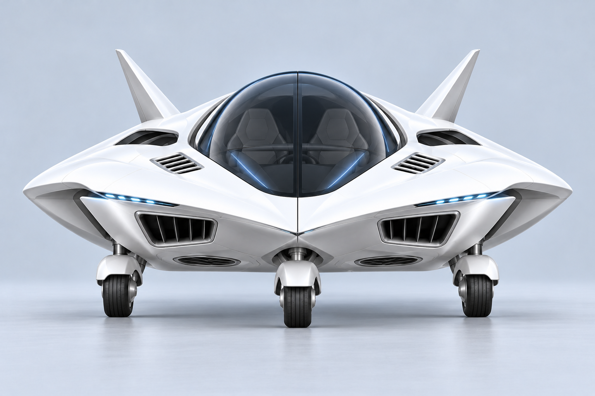
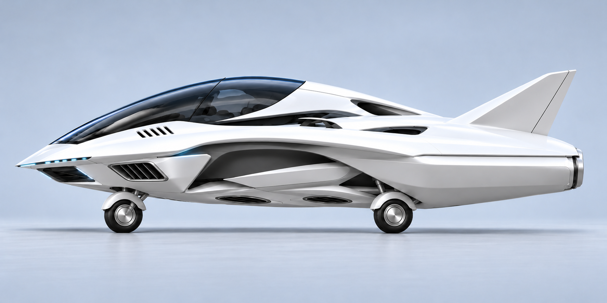
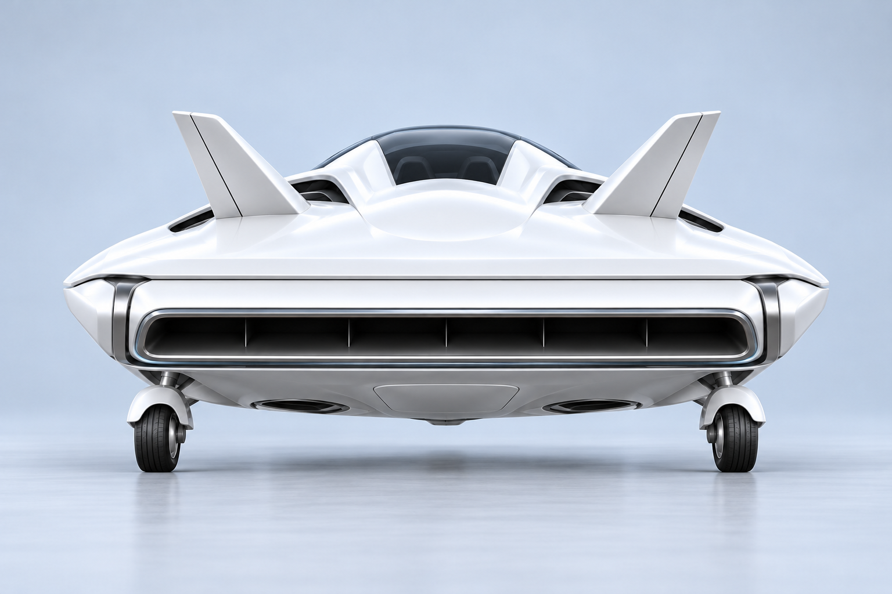
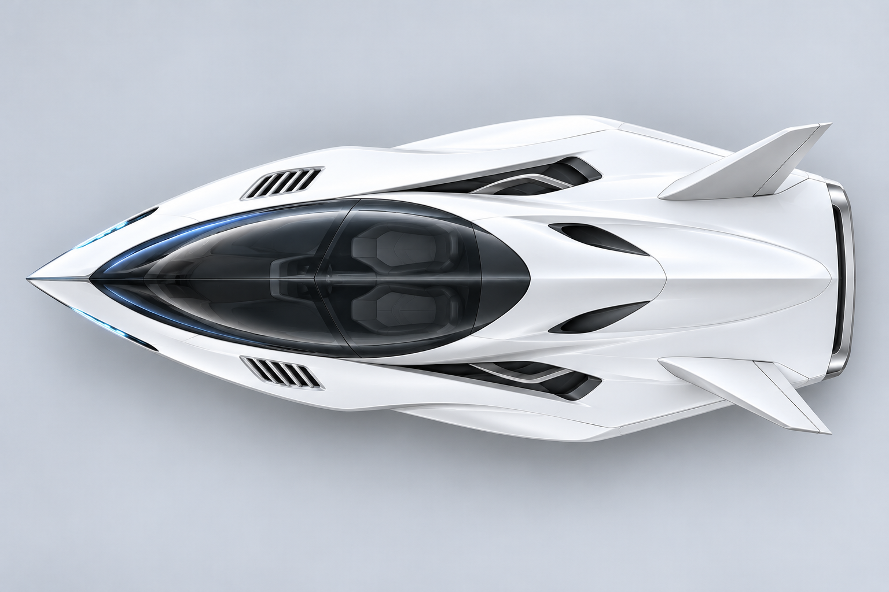

# 固定轮飞行器：四方向概念稿

保留白色流线外形、固定外露小轮和单条整体尾喷。四张分别绘制，均为无喷射的同一停放设定。

## 正面

## 侧面

## 背面

## 俯视

## 布局约定

- 前中央一轮、后左右两轮，固定短支架和半包轮罩；前轮与近侧主轮在侧面可见，远侧主轮正常遮挡。
- 四组机内升力单元，进气位于座舱外侧，底部出口与轮子、支架分开。
- 一个横贯尾部的浅型整体喷射模块，共用横向转轴，位于主轮之后；四张均采用朝后的停放姿态。
- 白色机身、银色机构、克制的浅蓝灯光，无夸张外露管道或大轮毂。

由内置 image_gen 制作，完整提示词见 [prompts.json](prompts.json)。本组是外观方向概念稿，未做三维逐点配准、结构干涉、动力或气动验证，尚未替换游戏资源。

