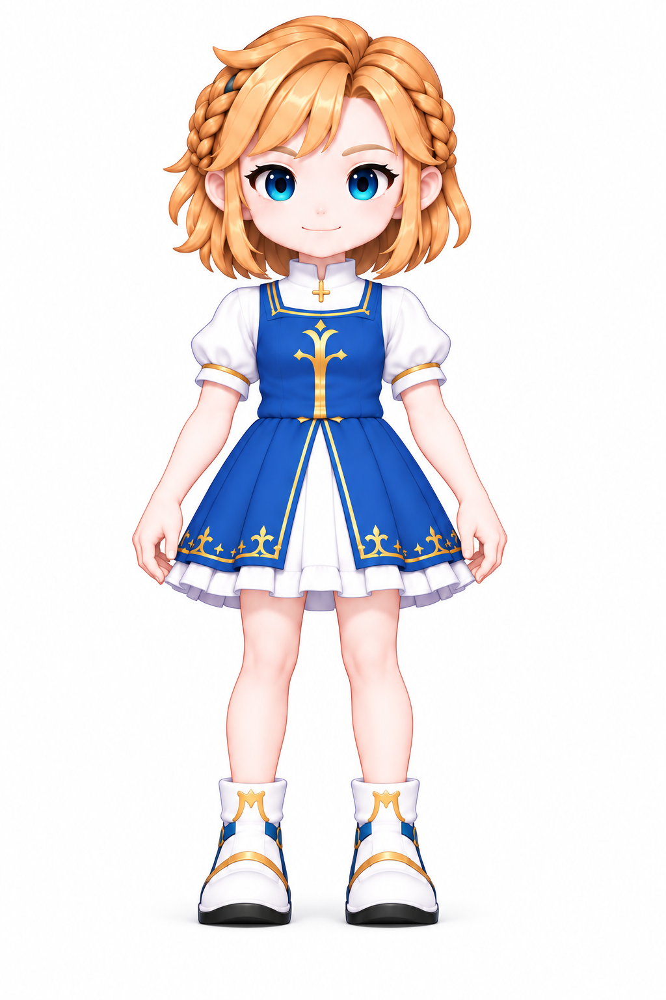
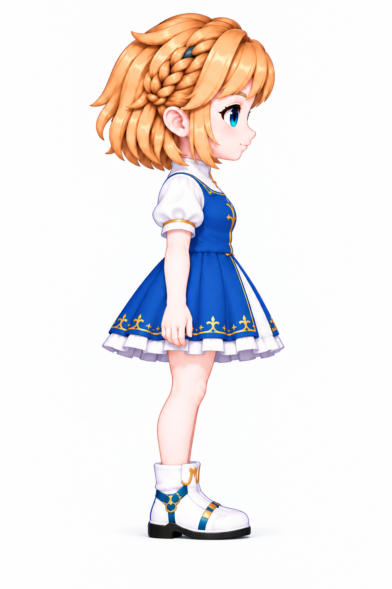

# 原图与设定资料来源

使用 D1 无装备概念原图。下面保留原图完整画幅，点击可查看原尺寸；此处不作为标尺对齐图。

[正面原图 ↗](protagonist-front.png)

[右侧原图 ↗](protagonist-right.png)

查看本页资料依据

世界与试玩范围：`README.md`
经济与生存草案：`public/concepts/economy.md`
构件尺寸与形态：`src/config/building-kit.ts` · `src/render/building/building-kit.ts`
当前家园数值与行为：`src/config/homestead.ts` · `src/sim/homestead.ts` · `src/sim/homestead-economy.ts`
场景与地形：`src/config/scene-demos.ts` · `src/config/facility-scenes.ts` · `src/world/tile-shapes.ts`
原图：`assets/characters/grassy/customization/female/concepts/d1-no-gear/individual/`
制图与比例记录：`assets/concepts/character-tile-scale/local-drawing/`
