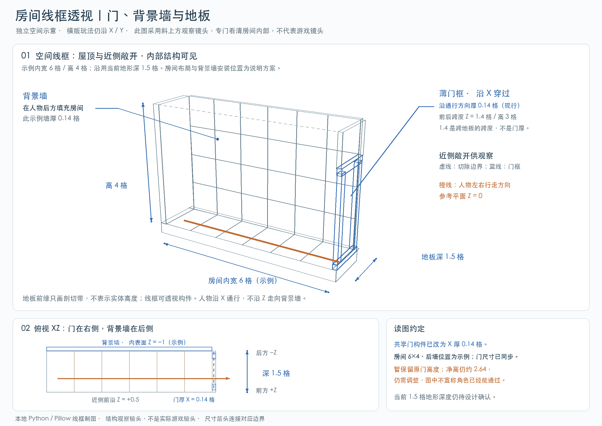
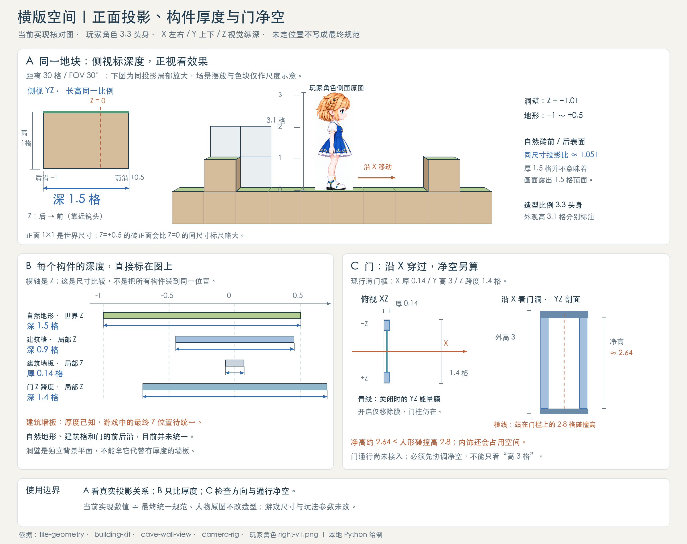
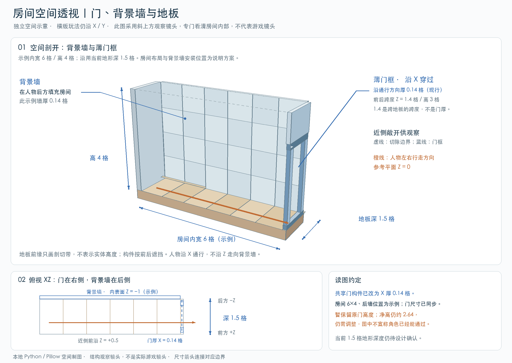

# 旧实现与历史图对照

展开旧资料（1.5 / 0.9 等旧深度不作为新规范）

以下保留已有实现和早期讨论的原始记录，若与上方六类新定义冲突，以上方新定义为准。

 [透视 · 单独场景 ↗](../?mode=resources&scene=room) [透视 · 大场景 ↗](../?mode=resources&scene=settlement)

当前房间试摆采用齐地形变体：地板、侧墙、屋顶及一体门的前后沿统一为Z=−1至+0.5，正面敞开。门外侧齐房屋右边界，门上方一格属于薄门楣，不再单独堆一块厚砖。下方较早的尺寸图仍用于说明基础门与标准建筑格。

以下记录当前构件库的实现尺寸，不代表前后沿与安装位置已经统一。先写宽 × 高，厚度独立列出，单位均为世界格；建筑构件的局部 Z 范围不能直接当作最终世界位置。

[查看最新房间透视：净宽9格、吊灯与墙窗 →](../?mode=concepts#building-house)

本次按单个横版房间绘制，取消二层和楼层平台。主图安装左门、右侧封墙；右门是镜像安装选项，不是第二个房间。借鉴泰拉瑞亚房间中实体边界、背景墙和入口分开的组织方式，不套用其NPC住房面积判定。本次将“7格高”按房间外轮廓总高处理：底板1格、室内净高5格、顶板1格。室内示例净宽6格，人物外观仍高3.1格。

- 前沿与封闭边界：地板、封闭侧墙和屋顶按格铺满，它们与前门柱的结构前沿统一到Z=+0.5。面向镜头的一面敞开以显示室内，背景墙铺在后侧，不把房间正面封死。
- 半格解释：本图将“留半个”按X左右方向处理。侧边一格分成外侧0.5格安装区和内侧0.5格留空区；左门靠左外沿、右半格留空，右门靠右外沿、左半格留空。门框仍厚0.14格，半格不是实心门厚度。
- 一体模块：门洞独立净高3格，上方1×1门楣与门框连为一个构件，模块宽1格、总高4格；门洞y=0至3，一体门楣y=3至4。再往上y=4至5补普通墙格，y=5至6是屋顶；底板y=−1至0，房间总高仍为7格。门无凸起门槛，左右版本同尺寸镜像，门高不随房间净高拉伸。
- 空间与状态：房体深1.5格、门沿Z跨度1.4格、背景墙厚0.14格，属于沿用的空间示意。门沿X穿过，不装在后墙上。家具按后侧装饰示意。此次只更新概念图与文档，本图三格净洞与一体模块属于修正方案，本次未修改游戏模型。人物碰撞高2.8格，外观3.1格的发梢余量还需协调；下方旧图记录原构件尺寸。

## 房间空间线框图

[打开房间空间线框图 ↗](room-space-wireframe.png)

本图单独展示房间的地板、侧墙、背景墙和门框。6×4 是示例房间大小，背景墙安装位置也为说明方案；1.5 格是当前地形深度，尚未作为最终设计确认。门沿 X 通行，背景墙在后侧。共享门构件已改薄，X 厚度为 0.14 格，Z 前后跨度仍为 1.4 格；两者不能混叫门深。图与共享门模型尺寸已同步；原门净高不足和通行未接入的问题仍保留。

## 现行构件尺寸：门已改为薄框

[打开格子、墙体与门概念图 ↗](tile-wall-door-depth.png)

正面都是 1×1 格，不代表厚度相同：自然地形从 Z=−1 到 +0.5，纵深 1.5；建筑格深 0.9；建筑背景墙板厚 0.14。洞穴背景墙则是 Z=−1.01 的独立平面，不等同于建筑墙板。建筑墙板的最终世界 Z 位置待统一；自然地形、建筑格与门的前后沿也不能假定已经对齐。墙层与实心碰撞层分开。

## 房间空间透视：门与背景墙

[打开薄门框房间透视图 ↗](room-space-perspective.png)

这是一张独立空间说明图，采用斜上方观察角度以看清内部，不代表正常游戏镜头。6×4 是示例房间；背景墙内表面临时放在 Z=−1、墙厚0.14，地板沿用当前深度1.5。门位于右侧，玩家沿X通行，不能把门画成走向背景墙的入口。房间布局、墙的安装位置与最终深度尚未定稿；门的净空问题仍需调整。

**建筑格**

**宽 1 × 高 1 格；标准厚 0.9，齐地形变体厚 1.5**

单格、连续三格、墙地转角与齐地形全深度单格。暖白封板与钴蓝包边，外露侧面和底部封闭。

**背景墙格**

**宽 1 × 高 1 格；厚 0.14**

单格、墙板拼接。薄墙用于人物后方背景层；最终世界 Z 位置待统一，与建筑格分层。

**能量门**

**沿 X 厚 0.14 格；高 3；Z 跨度 1.4**

关闭、开启两种预览。门框常驻；开启只关闭能量屏障，门洞沿横版左右方向通行。

**一体门楣组件**

**沿 X 厚 0.14；门高 3 + 门楣 1 = 总高 4；Z 跨度 1.5**

门与上方补格为同一个薄组件，安装在房间右侧外沿，前后沿齐地板。门楣常驻；开闭仅控制下方屏障，净高仍约2.64格。

**太阳能板**

**宽 1 × 高 0.5 × 深 2 或 3 格，居中**

整板左右倾转；踩踏受力，离开后渐进恢复朝向太阳。占位包含面板、转轴、底座及倾转范围，支撑砖独立。

门的 0.14×3×1.4 是整体包络，不能当作净通行空间。门洞与能量屏障位于 YZ 平面，角色沿 X 左右穿过；开启只移除能量膜。现有模型主框的竖向净空约 2.64 格，内槽还略占空间，小于人形碰撞高度 2.8 格；目前属于构件预览，通行逻辑尚未接入，接入前需统一门净空与碰撞。玩家角色仍按 3.3 头身参照、3.1 格外观高度和 0.8×2.8 格碰撞范围分别说明。

构件预览不等于全部已接入玩家建造。当前家园概念版的建造指令范围是太阳能板和仓库扩容。

 [查看场景资源与建筑构件 ↗](../?mode=resources)
