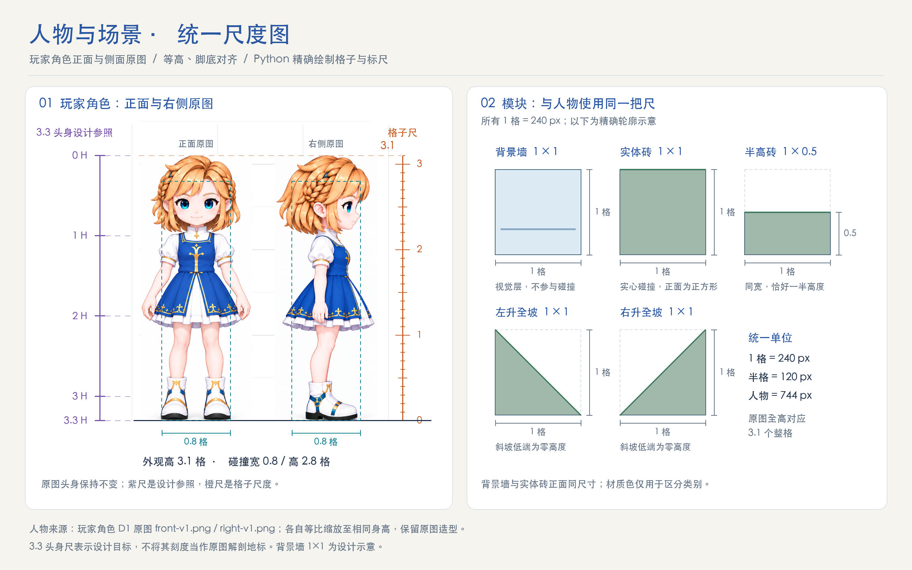

# 角色标尺标准

状态：已确认（2026-10-11）。所有角色原画的标尺图、正侧标尺与多形态拉通对比都必须使用本标准；与[概念页统一尺度图](./character-tile-scale.png)使用同一把尺。旧的“百分比尺”“按头高 H 刻度的读图尺”不再使用。

## 1. 尺度

| 项目 | 规定 |
| --- | --- |
| 制图单位 | 1 格 = 240 px。这是制图尺度，不是游戏固定屏幕像素 |
| 外观高 | 角色的**有发赤脚基础版**从最高发梢到脚底 = **3.1 格**（744 px），与游戏配置外观高一致 |
| 头身 | **3.3 头身**为设计目标：紫色参照尺把 3.1 格等分为 3.3 份，刻度 0 H、1 H、2 H、3 H、3.3 H，最后一段是 0.3 个头高 |
| 缩放 | 原图只允许整体等比缩放与平移，不单独拉伸头、身体或腿 |
| 地面 | 正面、侧面以及各形态的脚底（或鞋底）对齐同一条地面线 |

## 2. 两把尺

- **紫色 · 3.3 头身参照**：位于人物左侧，表示设计目标，**不是**读图地标；不能用它的刻度证明原图头身已校准。
- **橙色 · 格子尺**：位于人物右侧，从地面 0 格到 3.1 格，每 0.1 格一个刻度，0.5 格中刻度，整格标数字。

两把尺使用同一个地面和同一个 3.1 格顶线。

## 3. 同一角色的多种形态

1. 以该角色的有发赤脚基础版定倍率：发顶至脚底 = 3.1 格。
2. 无头发版、穿衣版、装备版**沿用同一身体倍率**，不各自再拉到 3.1 格。头发、鞋底、帽子造成的高度差必须保留。
3. 若某形态的原图与基础版尺寸不同（例如生成服务改变了输出尺寸），用已知的身体倍率 `body_scale` 换算，不按总高或颅顶归一。
   与基础版身材不一致的旧设计稿不直接放进对比：先以已对齐的形态为身体底图重绘（例如 D1 带装备 V2 以 V3 为底），再按已知倍率换算。
4. 地标虚线（头顶、下颚、胸部、腰、膝盖）以最左侧有发赤脚版正面为基准贯穿全部视图，标注离地高度（格）。
5. 两把标准尺画在 PNG 里，始终显示；虚线一律不画进 PNG：整格线、3.1 格顶线和地标线写在同名 `*.guides.json`（图片像素坐标），原画资料库与展示场原画对比栏点“显示虚线”时由程序叠画，再点隐藏。不再另存带虚线的图片版本。24 款换装角色与古典角色的标尺检查图同样换用这两把标准尺。

## 4. 读图标注

- 下巴、肩、腰、胯、膝、踝等地标为人工读图，误差约 ±5 px，标注为离地格数。
- 可在角落注明“读图约 X 头身”（发顶或颅顶至下巴口径），仅供与 3.3 目标比较，不改变标尺。
- 辅助线只画在人物之间的空白处，不压住角色像素。

## 5. 版式

- 纸色背景 `#F5F4EF`，人物放在白色圆角面板内；字体 STHeiti Medium。
- 颜色：紫尺 `#7550AA`，橙尺 `#C75C25`，标题 `#2856A3`，正文 `#21324A`，说明 `#627183`。
- 视图标签用“正面 FRONT”“右侧 RIGHT”。

## 6. 实现

- 共用实现：`assets/concepts/d1-proportion-rulers/ruler_standard.py`（尺度常量、两把尺、面板）。
- 正侧标尺：`draw_rulers.py`（同时写 `*.guides.json`）；三形态拉通对比：`draw_comparison.py`；对比图的整格与地标虚线数据：`draw_landmark_lines.py`。新增角色时在 `draw_rulers.py` 增加一组形态定义（基础版放第一个），三份脚本依次运行即可。
- 概念页统一尺度图：`assets/concepts/character-tile-scale/local-drawing/draw_scale.py`，另含 0.8×2.8 格碰撞框与地形模块。

## 透视图与交互演示

