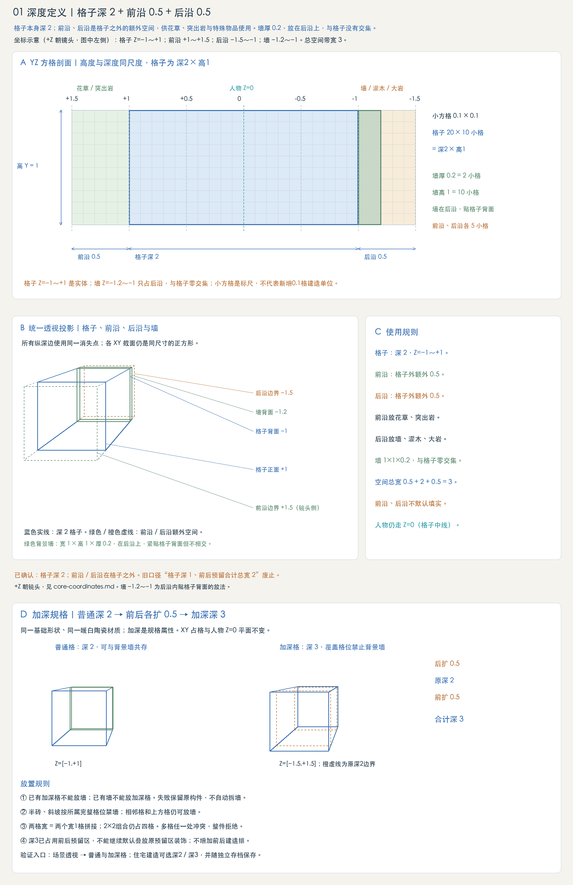
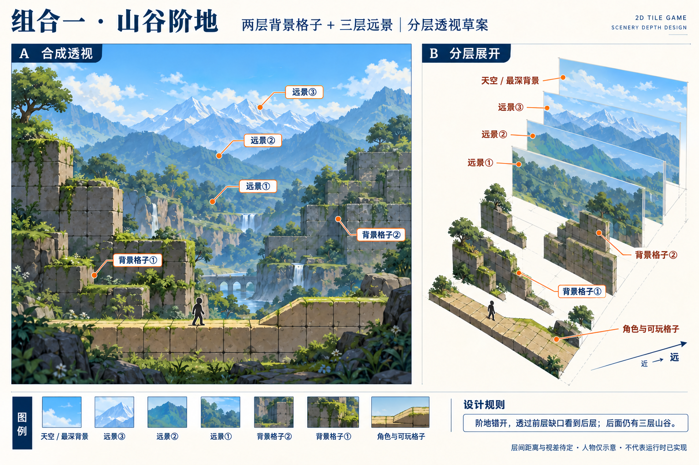
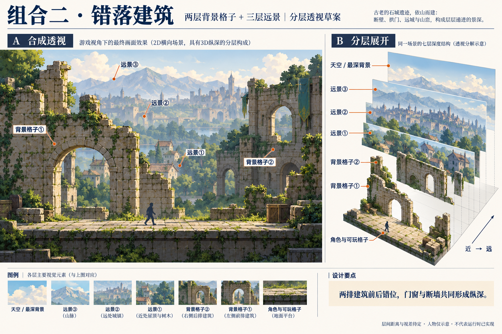
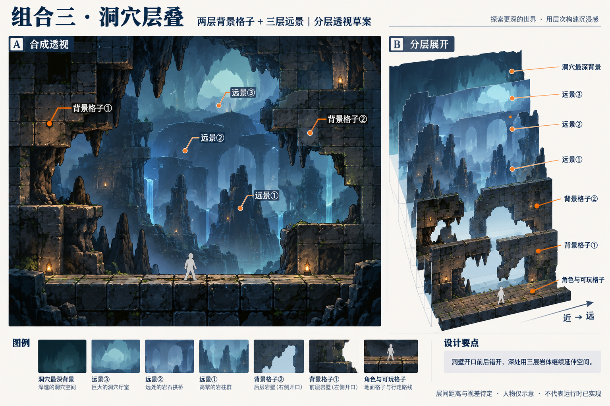
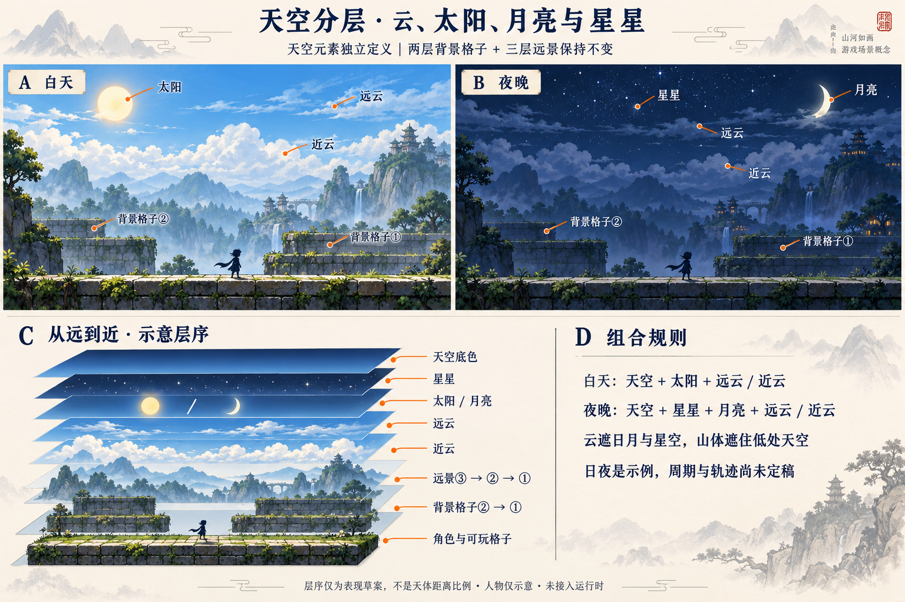

# 深度定义与线框透视说明

状态：已确认（2026-10-11）。设计规则；定义构件与透视预览已按本页实现，正式游戏渲染尚未同步。坐标按 [core-coordinates.md](core-coordinates.md)：+Z 朝镜头。

格子本身深2，Z=[−1,+1]；泥土、岩层、含矿格与建筑实体都占满格子深度，岩层不再向两侧露出。前沿[+1,+1.5]（镜头一侧）与后沿[−1.5,−1]是格子之外的额外空间，各0.5：前沿放花草、突出岩，后沿放背景墙、灌木、大岩。背景墙标准宽1×高1×厚0.2，XY完整覆盖一格、不缩边，位于后沿 Z=[−1.2,−1]，紧贴格子背面，与格子零交集。总空间带宽3格。

## 加深格标准（2026-10-14）

普通格默认深2。加深是基础格的深度规格，不另造一套材质或改变世界格网；加深格向前、向后各扩0.5，总深3，中心仍为Z=0，世界坐标包围Z=[−1.5,+1.5]。普通格、家具、墙、平台的既有默认规格不变。

- 加深格占用前后预留区，覆盖的基础格位禁止背景墙。已有墙时不能放加深格；已有加深格时不能放墙；失败保留原构件，不自动拆墙。
- 半砖、斜坡也按所属完整格位执行禁墙，不使用空半格容纳墙。仅禁止自身覆盖格位，上方和相邻格不受影响。
- 多格墙窗或组合构件先检查全部覆盖格；任意一格冲突时整件拒绝，不留下部分占位。拆除冲突构件后恢复允许放置。
- 宽2表示两个宽1的基础格拼接，2×2组合仍占四格。组合尺寸和深度独立，不引入前后第二排建造或Z方向移动。
- 加深不改变XY轮廓、支撑高度、人物玩法平面或家具后置规则。附着装饰不得继续默认占用已经填实的前后预留区；具体装饰适配另行验证。

透视入口：`/?mode=resources&scene=room#tile-depth`（场景透视 → 普通与加深格 · 深2 / 深3）。展示整砖、上半砖、两格拼接、四格组合、普通与加深接缝；右侧试放面板可验证双向禁墙、上方墙及拆除后重试。使用共享构件工厂、实际二维碰撞和透视格线，不复制一套展示模型。

住宅建造已接入深度规格：同一实体砖可选择普通深2或加深深3，预览、放置、拆除与独立住宅存档使用同一属性。旧存档未指定深度时仍为普通格，不自动改造旧布局。默认AI住宅主园廊及两侧分段园廊使用加深上半砖，室内楼板与门槛保持普通规格。原固定环境地台已改为居中深2、一格一缝；固定基底仍不可拆除，可建造园廊砖可以拆建。四格组合是占位演示，不代表已经实现可破坏的大石头资源。

## 空间分区

| 区域 | 范围 | 用途 |
| --- | --- | --- |
| 前沿 | Z=+1～+1.5 | 格子外额外0.5，镜头一侧，花草、突出岩 |
| 格子 | Z=−1～+1 | 完整深2；土、岩、半砖、坡形与建筑实体同深 |
| 后沿 | Z=−1.5～−1 | 格子外额外0.5，背景墙、灌木、大岩 |
| 墙 | Z=−1.2～−1，厚0.2 | 位于后沿，紧贴格子背面 |
| 家具 | Z=−1～0（深1） | 贴格子背面；只有深1一种 |
| 平台 | 无墙 Z=−0.5～+0.5（深1）；有墙 Z=−1～+0.5（深1.5） | 单向落脚面，前沿固定+0.5 |

## 已确定

- 格子深2；前沿、后沿在格子之外，不是把格子拆分出的部分。总宽0.5+2+0.5=3，墙在后沿内，不再加宽。
- 墙紧贴格子背面，与格子零交集。
- 泥土与岩层同为深2；旧规则“岩层前后各露出0.25”废止。
- 前沿、后沿不默认填实；花草、灌木、岩石与墙仍需避免实际轮廓互相穿插。
- 人物平面Z=0是2D逻辑基准。透视预览中人物平时走Z=0，横向离落地家具1格开始向镜头侧让到家具前沿+0.5，越过后回到Z=0；家具顶面（盆栽除外）可站立，站上时回到家具深度中心。
- 旧口径“中间实体深1、前延/后延各0.5、总宽2、墙 −0.7～−0.5”废止。

## 读图

A是按比例的YZ方格剖面：格子深2×高1，0.1×0.1小方格只是标尺。B是统一透视线框，镜头在 +Z 一侧：蓝色实线为格子，绿色/橙色虚线为前沿/后沿，绿色实线为背景墙。C列出使用规则。透视图中线段长度不能直接当尺量。

概念图：/concepts/building-depth.png

透视预览「长廊全建筑展示」分区可实际行走验证：`/?mode=resources&scene=room#depth-walk`。

## 背景、远景与近景分层草案

资料日期：2026-10-10。用户明确要求补上景别层级，近景可以直接由格子构成；后续 demo 的场景设计应包含这一关系。以下为本轮透视概念方案，具体镜头、层间距离、视差与前景遮挡处理尚未定稿，不代表运行时已实现。

- 背景：天空、整体色调与大范围氛围，处于最远处。
- 远景：远山、远处建筑或树林轮廓，用较淡的色彩与较少的细节表现距离。图中山谷题材仅为示例，不限定全部关卡风格。
- 近景：直接使用格子、半砖、斜坡与局部建筑形成空间，保留可识别的格缝和厚度；不把近景默认等同于花草装饰或平面贴图。
- 可选前景格子：可以在镜头与可玩空间之间加入局部格子构图，产生遮挡关系。该层是本图提出的可选方案，不据此增加 Z 方向行走或碰撞规则；应保持角色、敌人与落脚线可见。
- 房屋背景墙属于局部可玩空间的构件，与天空背景是不同概念。分层图将它单独展开只是说明关系，不要求每个场景都有完整墙层。
- 示意顺序由远到近：天空背景 → 远景 → 局部背景墙 → 角色与地形格 → 可选前景格子。实际物件仍按几何位置遮挡，不能把展开图理解为固定等距的平面卡片实现。
- 格子深2、前沿及后沿各额外0.5、墙厚0.2紧贴格子背面的已确认定义保持不变。新增前景构图不挤占前沿、后沿，也不将总带宽重新定义。
- 本图只用于讨论景别、前后位置和遮挡；人物、纹理格缝与层间间距不是可量取的尺寸标尺。人物与构件尺寸按已有定义执行。

概念图：/concepts/scene-depth-layers-perspective.png

## 多层背景格子与远景组合

最新确认：背景格子至少两层，远景也要分成多层，以形成空间纵深。上节单层局部背景墙的展开图是早期草案，不再作为完整场景的分层方案。近景仍可直接由格子构成。

本轮画出三种组合，每种采用两层背景格子与三层远景；“三层远景”是本轮示例配置，不表示以后只能有三层。由近到远依次为：角色与可玩格子 → 背景格子① → 背景格子② → 远景① → 远景② → 远景③ → 天空或洞穴最深背景。可选前景格子位于角色前方，不计入这两层背景格子。

| 组合 | 背景格子① / ② | 远景① / ② / ③ | 透视图 |
| --- | --- | --- | --- |
| 山谷阶地 | 前后错开的两排岩石阶地 | 林地山坡 / 山谷山体 / 远山天际线 | /concepts/scene-depth-valley-perspective.png |
| 错落建筑 | 前排断墙与拱门 / 后排错位建筑 | 近处屋顶与树木 / 远处城镇 / 山脉 | /concepts/scene-depth-buildings-perspective.png |
| 洞穴层叠 | 前层开口洞壁 / 后层错位洞壁 | 岩柱群 / 岩桥与洞拱 / 更深洞厅 | /concepts/scene-depth-cave-perspective.png |

两层背景格子在纵深上分开，轮廓与开口错位，让前层缺口露出后层，再看到远景；不能只把同一面墙换两种纹理，也不能用完全不透明的前层遮住全部后层。近层格缝与厚度清楚，远层逐步减少细节和对比；层距与视差见下节「层距与景深」。

局部建筑墙厚0.2紧贴格子背面的规定仍适用对应构件；两层场景背景不自动等同于在后沿塞入两道墙，也不修改格子深2和总带宽3的定义。独立背景层的距离见下节；几何厚度与资源配置尚未定稿。

三张图均为构图与遮挡概念，不是尺寸施工图、运行时截图或可直接导入的分层资源。人物、格缝、开口及展开间距不可直接量取；不引入额外Z方向玩法。具体题材只展示组合方式，不限制关卡必须使用这些风格。

## 层距与景深（方案 G）

状态：已确认（2026-10-13）。透视预览「场景分层」已按本节实现并默认开启「景深 G」；「旧层次」只为对比保留旧层距。正式游戏渲染尚未同步。

距离指该层基准面到玩法平面 Z=0 的格数，负值在玩家后方。镜头距玩法平面30格，视差 = 30 / (30 − 距离)，即该层随镜头平移的相对速度。

| 层 | 距离 | 视差 | 旧层距 |
| --- | --- | --- | --- |
| 近景遮挡 | 玩家前方3，整体下沉1格 | 1.11 | 前方3，不下沉 |
| 背景格子一 | −7 | 0.81 | −4 |
| 背景格子二 | −16 | 0.65 | −10 |
| 远景一 | −35 | 0.46 | −20 |
| 远景二 | −70 | 0.30 | −43 |
| 远景三 | −140 | 0.18 | −76 |

- 背景格子保持真实格子尺寸，推远后在画面中变小、格缝变密。三层远景是构图用的山林，推远时以 (24, 4) 为中心放大 (30 + 新距离绝对值) / (30 + 旧距离绝对值) 倍，从默认镜头看构图大致不变，只是移动变慢；这是近似补偿，换镜头位置会有偏差。
- 距离雾只作用于环境层，玩家与玩法地面不受影响。浓度 = 1 − 2^(−超出距离 / 25)，超出距离从镜头前0.3格起算，最多65%。雾色：白天取天空上、下两色之间（偏下色60%），夜晚 #3a4a66，洞穴 #16222f。远山剪影材质不接受雾，靠自身配色变淡，所以65%上限不保证各层明暗顺序。
- 近景遮挡下沉一格，少挡落脚线；画面上做高斯模糊（σ约为画面高度的0.24%）并压暗到82%，仍照常投影。
- 距离雾与近景模糊只在接近正面的镜头（与正面夹角约18°以内）启用；斜视、俯视和侧看层距时关闭，近景恢复清晰。
- 景深时玩法地面换成与近景同一种贴图：花园山谷、湖畔松林用泥土，其余场景用岩石。只换外观，碰撞不变。
- 云在约 −24 到 −60 之间多层漂浮，沿用共享天气系统，本节不调整。
- 层距目前写在透视预览里；正式关卡、游戏背景层与共享配置待游戏渲染同步时一并处理。

## 天空元素与日夜组合

补齐云、太阳、月亮和星星。它们独立于地形背景格子、远景山体定义；保持至少两层背景格子与多层远景的景别结构。

| 元素 | 表现草案 | 遮挡与层次 |
| --- | --- | --- |
| 天空底色 | 白天、夜晚两种示例色调 | 作为最远处底色 |
| 星星 | 夜空中的细小光点，避免与可交互物混淆 | 云与山体可以遮住星空 |
| 太阳 | 白天示例中清楚可见的日轮 | 位于云层之后，可被云及低处山体遮挡 |
| 月亮 | 夜晚示例采用月牙 | 位于云层之后；本图不规定月相系统，也不禁止白天出现月亮 |
| 远云 | 高处、较薄、较淡的云带 | 与近云分层，不与星星或天体烘成唯一固定贴图 |
| 近云 | 轮廓较清楚的云团 | 可覆盖远云与日月，具体移动和视差待定 |

图中由远到近的表现示意：天空底色 → 星星 → 太阳/月亮 → 远云 → 近云 → 远景③/②/① → 背景格子②/① → 角色与可玩格子。天体顺序只用于说明表现与遮挡，不是天文学距离，也不规定日月必须同时出现。云层与山体的局部穿插可按具体场景另定，不据此规定所有天气只有两层云。

白天组合展示天空、太阳及远近云；夜晚组合展示天空、星星、月亮及远近云。同一场景用昼夜两种状态比较，人物只示意活动位置，不能量取比例。洞穴使用内部最深背景；没有通向天空的开口时，不把日月星云直接叠进封闭洞穴。

图中只定义组成与空间关系。昼夜周期、天体轨迹、月相、天气转换、云速、视差和实际照明均未定稿；不据此声称运行时已经具备相关系统。

概念图：/concepts/scene-depth-sky-perspective.png

## 可进入的分层演示

入口：导航 → 透视 → 场景分层；直达 `/?mode=resources&scene=depth`。概念定义页也提供进入链接。

演示共用48格可行走地面与三组平台，包含六个完整环境：

| 场景 | 主体与景观 |
| --- | --- |
| 花园山谷 | 樱树、白桦、花带、岩桥和三重青山 |
| 湖畔松林 | 松林、柳树、石岸、芦苇、小屋和碧水 |
| 海岸小镇 | 棕榈、门窗完整的小屋、灯塔、海湾水带和远岛 |
| 层叠城镇 | 花坛、庭院树、完整屋顶、高塔和前后街区 |
| 月夜遗迹 | 月亮星空、残殿、苔石、蕨草和幽蓝晶光 |
| 晶石洞厅 | 厚岩壁、钟乳石、青紫晶簇、水池和更深洞桥 |

默认以轻微斜视展示线框大场景：地形格、坡形和建筑显示无纹理的淡色半透明面，保留格网、真实几何边缘和砖块厚度，树木、花草与天空继续作为效果参考。工具栏「透视线框 / 实景」切换显示，「大场景全览」恢复全景；「真实游玩视角」同时恢复实体材质和玩家正常跟随镜头。观察点仍可切换位置，显示模式独立于镜头。角色复用游戏模型、动画与移动碰撞，背景不参与玩法碰撞。线框模式暂时禁用格线和半透明选项，避免冲突；实景模式仍可独立检查它们。

真实树冠通过共享planTree数据生成，花草、灌木、景观石、岩土纹理、水体与晶石均复用游戏资源工厂。水体是共享水带示例，不代表新增海洋系统。两层背景与三层远景保持独立，层距按「层距与景深」一节；工具栏「景深 G / 旧层次」切换规则层距与旧层距对比。

每景三个观察点，共十八处。控制面板提供近景、背景格子一/二、远景一/二/三、云、日月星空八项，可逐层关闭或恢复；玩家地面始终保留。洞厅禁用天空项，遗迹默认夜晚，其余户外默认白天。「侧看层距」查看纵深，「风景全览」返回完整构图，观察点返回玩家视角。

户外可手动切换白天和夜晚，查看太阳、月亮、星星与云的遮挡。日月实体直径约占画面高度一成，按镜头视角补偿尺寸，不按天文距离缩成小点；当前夜间采用满月，概念图中的月牙保留为其他组合。洞穴隐藏天空元素。自动昼夜周期、天体运行轨迹与完整天气变化仍未实现。

## 植物与矿脉补充

花草、盆景、树木的成熟包络、根部支撑与预留区使用，以及矿脉的地形格归属，见 [植物、生长物与矿脉定义](natural-resource-definitions.md)。新增尺寸与生长状态为草案；预留区不自动生成承托面，矿脉不随植物再生。

格子上的顶面苔、前立面苔、包边苔、垂挂苔，以及前沿内的草花、树木逐格高度和矿脉围岩开采结果，见 [自然资源空间定义与四张透视图](natural-spatial-definitions.md)。

## 透视图与交互演示

[查看岩层线框与透视 →](../?mode=concepts#natural-rock)

[打开普通与加深格 · 实际透视及规则试放 →](../?mode=resources&scene=room#tile-depth)

[进入场景分层演示：操控玩家查看山谷、建筑、洞穴与日夜天空 →](../?mode=resources&scene=depth)
