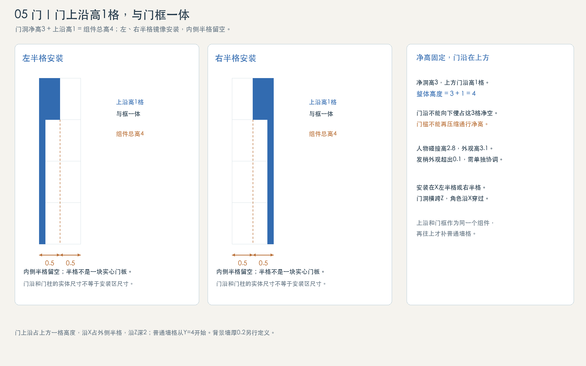

# 门组件与深蓝合金能量门

**最新定义：门竖向占4格，是留给整套门发挥的设计空间。净洞、门扇、门框与机构可按门型分配，不固定为3格门洞＋1格实体门楣。**

| 类型 | 空间与外观 |
| --- | --- |
| 厚重门 | 允许厚门扇、宽门柱、厚上框或机构；具体厚度与开门方式另定。 |
| 能量门 | 门框、发射器与能量屏障组成入口；不要求有实体门扇。 |
| 3.5格高门 | 可按净洞3.5＋顶部0.5范围做门框；顶部仍属于门，0.5不要求全部填实。 |

- 4格是安装和设计范围；实际外观、开启净空与关闭阻挡分别定义。顶部可以只做门框，不必补一块普通砖。
- 左右镜像与侧边半格安装范围沿用；厚重不表示可以随意超出X/Z边界。门沿X通行，不改装成背景墙入口。
- 人物仍高3.1格、3.3头身；净高3.5示例留下0.4格站立外观余量，动画与碰撞仍需核对。当前已接入下节的深蓝合金能量门；厚重实体门等其他门型仍为设计范围。

## 当前深蓝合金能量门

- 材料为深蓝合金，提供左右安装方向。注册占位宽1×高4；门框实际沿X占半格，Z方向标准占深2，位于Z=[−1,+1]。粒子、辉光和开门时消散的能量不额外扩大建筑占格。
- 当前门洞净高3.5，顶部0.5用于门框；净空与关闭阻挡由共享门实现生成，不再使用旧图固定3＋1比例。
- 玩家靠近自动开启、离开自动关闭；关闭前检查人物仍在门内时不合闸。能量屏障开合使用消散与重聚表现，门框保留。
- 来源：`src/config/residence.ts` 的门资源、`src/render/city/ai-city-architecture.ts` 的 `createAiCityDoor` 和 `src/sim/building.ts` 的门碰撞与自动感应（门是特殊构件，开合只在模拟步内按 tick 改变）。尺寸是当前门型标准，不要求所有未来门型使用相同净高和机构。

[下载房间与门的最新定义](room-layout-definitions.md)

旧3＋1门图：仅作一种外观示例

