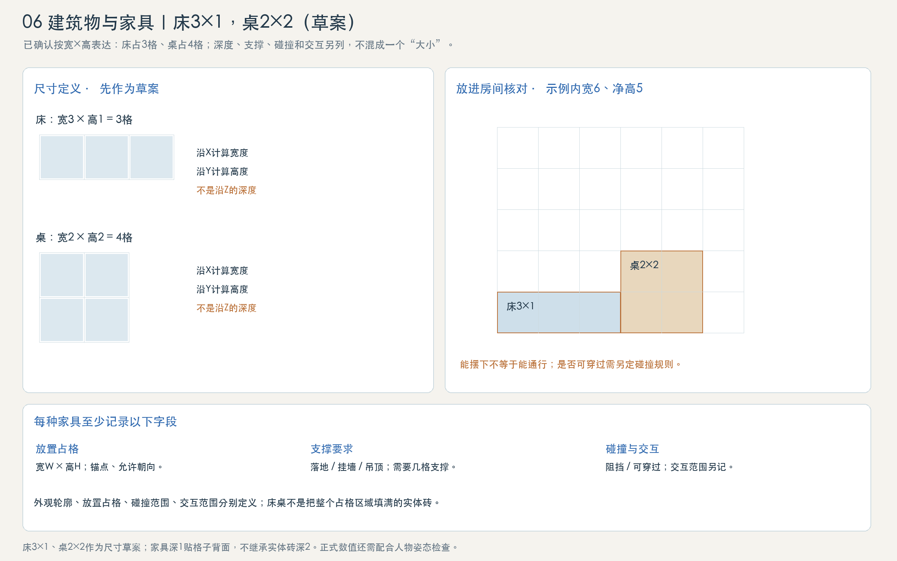
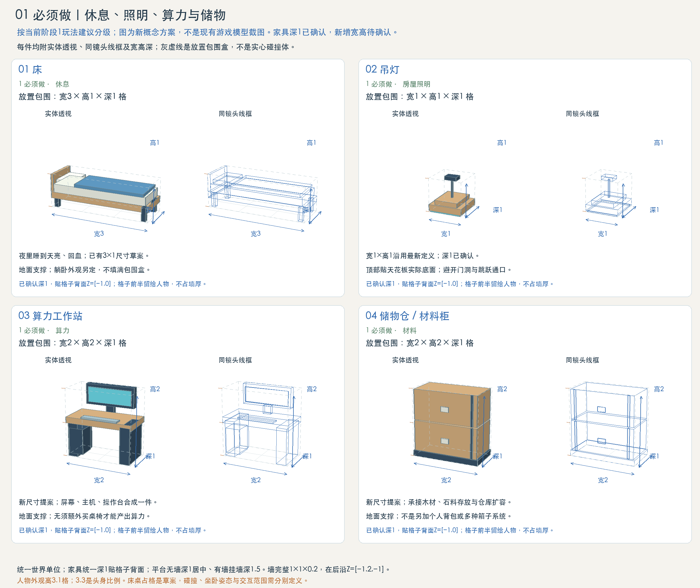
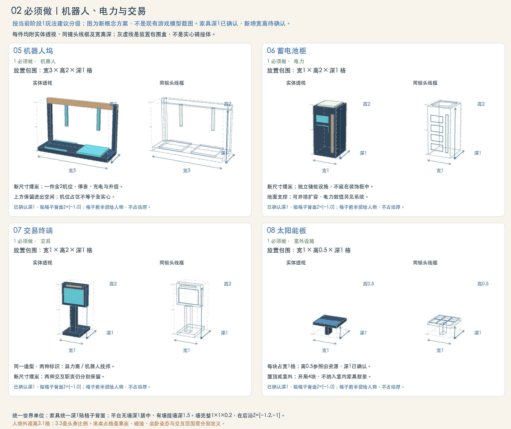
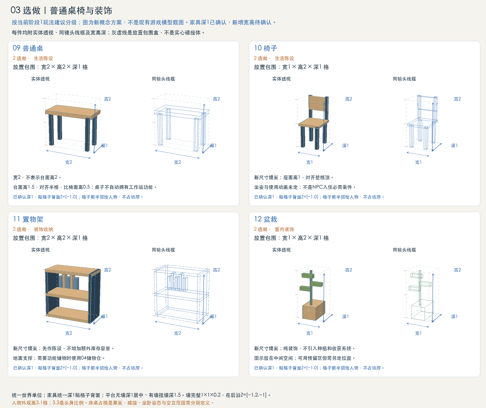
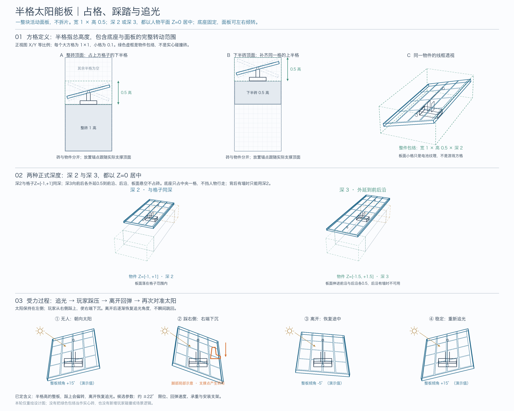

# 当前家具与设施定义

状态：家具空间标准与现有资源（2026-10-16 更新）。当前目录已登记蓝白合金家具、灯具、盆栽及功能设备，名称与占位以[材料与构件库](material-library.md)为准。经济职责与未来交互仍依据“阶段1”草案，不能只因造型已接入就声称对应玩法已完成。深度按2026-10-11新定义：家具深1贴格子背面，人物经过时向镜头侧让位，顶面可站；全部家具统一深1（深0.5候选已删除），原宽高保留。太阳能板宽1、高0.5，正式保留深2与深3两种，都以人物平面居中，整排安装在旅舍屋顶。表中已登记宽高用于当前资源放置；经济玩法不因模型接入自动定稿。这里同时列出生活家具与功能设施，避免只画桌椅却遗漏支撑玩法的物件。

## 1. 为什么需要这些物件

当前循环是探索采集、机器人搬运与建造、电力供应、算力生产、闲置算力换Token、购买升级、夜间休息。因此第一批应覆盖休息、照明、算力、材料、电力、机器人停靠和交易。

建议第一批8类造型：床、吊灯、工作站、储物仓、机器人坞、蓄电池柜、交易终端、太阳能板。其中交易终端共用造型，但分别保留算力组件商和机器人技师两种标识及交互；太阳能板属于屋顶或室外设施。8类不等于开局只摆8件：开局太阳能板4块、交易终端两种，照明数量随房间布置而定。

普通桌椅不应成为工作站运行的额外前置条件；不照搬其他游戏的“桌+椅才能入住”判定。门、窗、背景墙、楼板与平台仍归建筑构件，不计入家具种类；机器人是活动角色，机器人坞才是设施。

## 2. 已登记家具与功能设备

所有尺寸按宽X×高Y×深Z，单位为格；表中为放置包围，不代表整个体积填满或整块阻挡。数量和尺寸状态分别说明。

| 编号 | 物件 | 当前用途 | 图示宽×高×深 | 尺寸状态 | 放置方式 |
| --- | --- | --- | --- | --- | --- |
| 01 | 床 | 夜里睡到天亮、回血 | 3×1×1 | 当前占位3×1；深1已确认 | 贴实际地板顶面；躺卧姿态另定 |
| 02 | 吊灯 | 已要求的房间照明 | 1×1×1 | 宽1高1沿用最新房屋定义；深1已确认 | 顶部贴实际天花板底面，避开跳跃通口 |
| 03 | 算力工作站 | 通电产出算力、安装算力组件 | 2×3×1 | 含悬浮显示器总高3已确认；宽2、深1 | 主机、显示器、操作台为一件；桌面高1.49，落地 |
| 04 | 储物仓 / 材料柜 | 木材石料存放、机器人卸货、仓库扩容 | 2×2×1 | 当前占位；深1已确认 | 落地；沿用仓库职责，不另造个人箱子系统 |
| 05 | 机器人坞 | 停靠、充电、机器人管理 | 3×2×1 | 当前占位；深1已确认 | 一件展示2机位；保留进出空间，升级入口交互另定 |
| 06 | 蓄电池柜 | 储能、夜间供电、并排扩容 | 1×2×1 | 当前占位；深1已确认 | 落地；状态条表现电量，数值见经济系统 |
| 07 | 交易终端 | 算力组件商、机器人技师购买入口 | 1×2×1 | 当前占位；深1已确认 | 同一造型两种配色和标识，两种职责不合并 |
| 08 | 太阳能板 | 初始发电与后续建造 | 1×0.5×2 / 1×0.5×3 | 整件占半格高，已确认；深2与深3两种正式，含面板、底座及倾转范围 | 实心地面或屋顶支撑；踩踏倾转，离开后恢复追光；开局4块 |

吊灯列入第一批是因为用户已要求房屋灯具，不意味着本次新增灯具耗电、开关或光照玩法。机器人坞不是一块填满3×2的实体砖；两个机位是功能容量与停靠展示，不自动等于两个不可穿过的碰撞盒。

工作站现行整件占位为2×3×1，桌体加高半格，桌面高1.49，桌上物件与悬浮显示同步上移半格。界面参考苹果头显的空间设计：灰白半透明圆角窗口、独立悬浮工具条、柔和彩色内容和柔白投影。默认每10秒在空间窗口、3D地球仪、空间控制台之间轮播。三态具有真实前后层次，共用投影底座与家具尺寸，供电关闭时全部熄屏。下方概念图的工作站标注仍为旧版2×2，现行尺寸以本表及游戏资源为准。

图片：/concepts/furniture-essential-home.png

图片：/concepts/furniture-essential-systems.png

## 3. 已登记生活家具与盆栽

| 编号 | 物件 | 图示宽×高×深 | 说明 |
| --- | --- | --- | --- |
| 09 | 普通桌 | 2×2×1 | 宽2，深1已确认；台面高1.5，对齐半格，比椅面高0.5；上方为空，不等于2格高实心桌 |
| 10 | 椅子 | 1×2×1 | 当前占位；深1已确认；座面高1，对齐整格顶；朝前、朝左、朝右三个方向，侧向时靠背立在背对的一侧；坐姿、动画与交互未定 |
| 11 | 置物架 | 2×2×1 | 当前占位；深1已确认；先作装饰，不与功能储物仓重复增加库存系统 |
| 12 | 盆栽 | 1×2×1 | 当前占位；深1已确认；纯装饰，不引入种植、浇水和收获玩法 |

图片：/concepts/furniture-optional.png

补充：12号盆栽保留为原静态陈设方案；活植物与盆景的生长状态、根部支撑和矿脉定义见 [植物、生长物与矿脉](natural-resource-definitions.md)。新增生长规则为草案，不代表已启用种植玩法。

## 4. 3 当前不重要：暂不制作

- 厨房、灶台、冰箱：阶段1不包含食物系统；后续若启用料理，再结合厨师职责决定是否要独立家具。
- 衣柜、梳妆台、浴室与卫生设施：当前没有需要它们的家居玩法，不建立新的生存指标。
- 地毯、挂画、成套沙发及大量花色：先保留可能用途，不画全套、不要求全部支持。
- 独立制造工坊、机柜、集群、核电等属于后续功能设施，后续系统启用时重新分级，不能把“当前不做”理解为永久无用。阶段1由机器人承担建造，不为每个制造动作新增一件桌台。

## 5. 格子、深度与支撑

- 游戏逻辑仍为XY二维，家具用三维几何表现；X左右、Y上下、Z前后。
- 格子深2：Z=[−1,+1]；前沿[+1,+1.5]、后沿[−1.5,−1]在格子之外各0.5；墙厚0.2，位于后沿Z=[−1.2,−1]。背景墙仍宽1高1，不随家具尺寸缩边。
- **家具深度统一1格，已确认**。家具贴格子背面，深度包围为Z=[−1,0]，格子前半留给人物。家具的深度包围不表示腿、吊杆等每个部件都填满1格。平台按有无背景墙分居中深1与挂墙深1.5，不能套用到家具。
- 家具紧贴格子背面，与后沿的背景墙零交集。前沿、后沿可给花草及特殊物品，本批落地设施不挤占。
- 床、桌和设备底面贴所放楼板的实际顶面；整砖或半砖都按实际支撑高度摆放，不强迫家具回到整数Y。
- 吊灯宽高1×1包含底座、吊杆、灯罩；安装在天花板实际底面，不把灯具自身高度和屋顶格子合并。
- 2格宽层间通口及平台上方通行空间保持可用，家具不摆进通口。人物外观高3.1，碰撞宽0.8高2.8；3.3头身不是占高3.3格。
- 床3格长接近人物外观高3.1：床长含床头，真正可躺面更短，因此床3×1继续标草案，不能声称已经通过躺卧姿态验收。后续用原图躺姿核对后再定床垫长度。

## 6. 放置范围、外观、碰撞、交互分别定义

每件需记录：ID、用途、放置宽高、外观深度、锚点、实际支撑面、朝向、碰撞类型、交互范围、资源状态。包围盒只用于尺寸与摆放讨论，不自动生成实心碰撞。

家具深1不自动决定阻挡规则。落地家具（盆栽除外）的顶面按第7节作为单向落脚面；侧向阻挡和状态变化尚未定稿。桌下空隙不表示角色能钻过去。

最少表现建议：工作站开机/断电；蓄电池电量条；机器人坞空闲/停靠/充电；交易终端两种身份；太阳能板昼夜状态。复用同一基础造型的状态变化，不为每个状态制作新家具类别。床的睡眠交互与人物躺姿另行验证。

## 7. 家具与人物站位（2026-10-11 已确认）

已确认：家具深1、人物外观高3.1格、3.3头身比例不变。格子深2，家具贴格子背面占Z=[−1,0]，格子前半Z=[0,+1]留给人物通行。

| 规则 | 内容 |
| --- | --- |
| 中线行走 | 人物平时走Z=0，与平台、地形的二维碰撞不变 |
| 经过家具让位 | 横向离落地家具1格开始，人物向镜头侧平滑让到家具前沿+0.5（深1家具为Z=+0.5），背包不会陷进家具，越过后回到Z=0；间隔小于约2.6格的家具之间保持让出，不来回摆动 |
| 站上家具 | 落地家具的落脚面（盆栽除外）是单向平台，可跳上站立；一般取整件顶面，椅子取座面（高1，对齐整格顶，和站在整砖上一样）而不是靠背，算力工作站取桌面（高1.49）而不是屏幕；站上时人物回到家具深度中心（深1家具为Z=−0.5） |
| 吊灯与太阳能板 | 两者都不挡人物行走，以人物平面居中：吊灯深1占Z=[−0.5,+0.5]，不触发让位；太阳能板居中安装，正式为深2与深3两种，按第9节单独处理 |
| 平台上的家具 | 居中与挂墙两种平台都可以放家具，和砖上一样贴格子背面占Z=[−1,0]；经过时和砖上一样让到家具前沿+0.5，约一半身体伸出平台前沿，不会掉下去；平台拆除后的家具级联处理尚未接入，见平台定义第10节 |

让位只是表现层的Z偏移，逻辑仍为XY二维；前沿[+1,+1.5]仍留给花草和突出岩，不改成人物走道。净高5的房间里，床垫高0.78加人物3.1可以容纳；站在2格高柜顶时外观总高5.1会碰到天花板，摆放时需检查头顶净空。坐卧时可以进入独立交互姿态，另行验证。

## 8. 长廊全建筑展示：家具让位与站立

入口：/?mode=resources&scene=room#depth-walk （长廊全建筑展示）。室内段地面摆三张床（长3）、盆栽、桌椅（两侧椅子朝向桌子）和置物架；上方两排平台整段拉通，各放入全部家具：下排背后有墙，挂墙深1.5，深3太阳能板会伸进后沿撞墙，空出这一格；上排高过墙顶，居中深1。室外依次为全部花草（根长在格子顶面上、铺满整格，前后棱的叶片伸进前沿与后沿，不悬空长在沿上）与灌木（格子内后置）、垂藤台阶及其上方的悬空两格（前后上棱挂游戏三种垂藤，长1.5 / 2.2 / 3，底面内部再生一排垂藤）、全部树种（冠团约占Z −1.5～+0.3，树冠平台可站立；经过树干时和家具一样，离树干1格开始让到树干前沿+0.5）、全部岩石（按游戏四档：碎石可踩过；中石、大石按游戏规则成组，经过让位，大石顶面可站；景观岩占背景墙那一层，所在列不修墙，见岩石定义）和浅中深三个水池。家具、植物、岩石、水和男玩家都复用游戏共享资源；荒漠、洞穴与水生植物暂未放入。

大场景与单独场景的家具统一深1，贴格子背面占Z=[−1,0]；深0.5候选及其对比图谱已删除。旧版六种站位对照（后半格床、侧边交互、站床上、直接穿模、左右阻挡、穿过淡化）及其测量面板已删除，由本节规则取代。

## 9. 半格太阳能板：占格、踩踏与追光

已确认图稿：[Python线框透视图](/concepts/solar-grid-and-load-perspective.png)。交互入口：[透视场景 · 太阳能板](/?mode=resources&scene=room#solar)。

- 整件宽1、高0.5，包含底座、转轴与整块面板的倾转包围；支撑砖独立。半格指物件高度，不拆成上、下两片。
- 正式深度两种，都以人物平面Z=0居中：深2占Z=[−1,+1]，与格子同深；深3占Z=[−1.5,+1.5]，向前后各外延0.5到前沿、后沿。深1候选及前偏、后偏摆放已删除。
- 底座贴支撑面：放在整砖上，占上方格子的下半格；放在下半砖上，补齐同一格的上半格。面板内的电池小格只是表面分格，不是游戏占格。
- 面板整板绕前后方向的轴左右倾转。玩家踩在左侧时左端下沉，踩在右侧时右端下沉；离开后逐渐恢复朝向当前太阳，不瞬间复位。
- 底座只占中央一格，加深只延长板面与转轴；太阳能板不挡人物行走。深3伸进后沿，会与墙（Z=[−1.2,−1]）相交，背后有墙时只能用深2。
- 透视场景用于核对整砖、半砖、两种深度，以及踩踏后恢复追光；全部家具分区并排展示深2与深3；不把线框图中的演示角度、承重与恢复速度视为最终调参。
- 大场景旅舍屋顶已连续铺12块面板，由右侧室外平台连接主街：[屋顶太阳能试玩](/?mode=resources&scene=settlement#solar)。每块独立受力、恢复追光。

## 10. 资料依据与实现边界

- `public/concepts/economy.md`：阶段1的开局、包含系统、美术需求；完整经济设定是设计资料，不把其中所有后期物件纳入本轮。
- `public/concepts/room-layout-definitions.md`：床3×1、桌2×2草案，最新吊灯1×1，人物尺寸、通口避让与实际支撑面。
- `public/concepts/depth-definitions.md`、`public/concepts/platform-definitions.md`：格子、墙、前沿与后沿；家具深度与平台规则分别处理。
- `src/render/residence/homestead-view.ts`已有工作站、仓库、机器人坞、蓄电池、交易终端等简化表现；`src/config/homestead.ts`及`src/sim/homestead.ts`已有相关配置和设施。当前住宅与搭建场尺寸由共享资源配置登记，不与经济模式的简化示意尺寸混用。

三张图由本地Python绘制，每件附实体透视与同镜头线框，所有对象共享相机和单位尺度。当前家具已接入实际放置、逐件拆除和共享承托碰撞；相关行为已有专项测试。角色坐卧动画尚未制作，经济设施的完整功能不能仅凭模型推断。旧图的制作优先级保留作历史记录，当前可选项以材料与构件库为准。

## 透视图与交互演示

[打开可游玩透视场景 · 长廊全建筑展示 ↗](../?mode=resources&scene=room#depth-walk)

[植物类 · 盆景与盆栽](../?mode=concepts#natural-bonsai-definitions)

[进入透视场景 · 太阳能板踩踏与追光 →](../?mode=resources&scene=room#solar)
