# 材料与构件库

按“类别 → 资源”查阅外观、贴图和支持形态。当前登记 36 种资源、341 个可选形态；形态变化不重复计为新材料。

图片来自共享游戏工厂：构件图展示整体外观，自然材料附实际色彩图，程序建筑材质附表面渲染快照。点击图片可查看原图；实际光泽随场景光照变化。

资料来源与更新

正文由 src/config/residence.ts、src/config/definition-kit.ts 生成；附属构件包络来自 src/render/city/ai-city-architecture.ts。修改资源后运行 npm run docs:resources，不直接编辑生成正文。材质或模型改变时，在 Vite 浏览器环境调用 scripts/export-material-previews.ts 的 exportMaterialPreviews()，重新导出 material-previews 图片快照。网页与 HTTP Markdown 使用同一份图文，LLM 索引见 [llms.txt](../llms.txt)。

## 查看入口

- [分类与命名](resource-classification.md)
- [自由搭建场](/?mode=lab&demo=sandbox)
- [材料与形状](/?mode=lab&demo=tiles)
- [AI 住宅](/?mode=lab&demo=residence)

所有条目均可在住宅与自由搭建场选择、铺设和移除。登记占位表示锚点范围；小块按实际轮廓占格，不会填满整个父格。

## 通用约定

普通实体深 2，加深深 3。一个格可放四个互不重叠的四分之一块；任一加深小块禁止整个父格的背景墙。米黄色方石用于铺地、砌墙和盖房，同形、同高、同深度的固定相邻配对可合缝，逻辑仍逐格编辑。

平台是一个构件类型：整宽、左右半、挂墙与顶齐是平台内部属性。家具属于蓝白合金系列，软垫和织物不会因系列名变为金属。

家具标准占位深1，通常贴格子背面占Z=[−1,0]；悬吊灯深1但居中占Z=[−0.5,+0.5]。本表太阳能板为居中深2；透视定义另外支持深3方案，不能据此把它当成目录中另一个家具材料。深度字段中的“标准占位”不把全息投影或柔性叶片当成实心碰撞体；“模型包络”从实际构件几何测量，取到小数点后四位，花槽包含植物伸出部分。

## 块

### 暖白岩板块

<figure>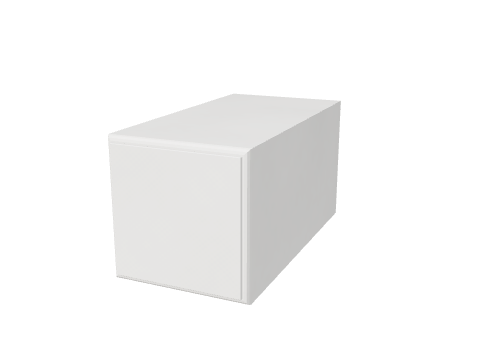<figcaption>游戏构件预览</figcaption></figure>
<figure><figcaption>程序材质表面 · 渲染快照</figcaption></figure>

表面由程序材质生成，没有独立图片贴图；上图展示实际纹理与光泽。

| 形态 | 支持方向 / 旋转 | 实际宽×高（格） |
| --- | --- | --- |
| 整砖 | 标准 | 1×1 |
| 半砖 | 下、上、左、右 | 1×0.5 / 0.5×1 |
| 四分之一砖 | 左下、右下、左上、右上 | 0.5×0.5 |
| 整格坡 | 右下、左下、右上、左上 | 1×1 |
| 缓坡低段 | 右升、左升；0°、90°、180°、270° | 1×0.5 / 0.5×1 |
| 缓坡高段 | 右升、左升；0°、90°、180°、270° | 1×1 |
| 双斜尖顶 | 0°、90°、180°、270° | 1×0.5 / 0.5×1 |

**深度：**2 / 加深 3 格。实心；按实际轮廓组合；加深禁止整父格背景墙。

### 深蓝合金块

<figure>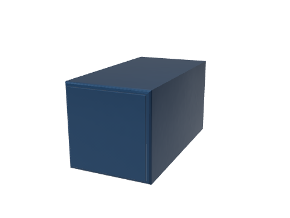<figcaption>游戏构件预览</figcaption></figure>
<figure><figcaption>程序材质表面 · 渲染快照</figcaption></figure>

表面由程序材质生成，没有独立图片贴图；上图展示实际纹理与光泽。

| 形态 | 支持方向 / 旋转 | 实际宽×高（格） |
| --- | --- | --- |
| 整砖 | 标准 | 1×1 |
| 半砖 | 下、上、左、右 | 1×0.5 / 0.5×1 |
| 四分之一砖 | 左下、右下、左上、右上 | 0.5×0.5 |
| 整格坡 | 右下、左下、右上、左上 | 1×1 |
| 缓坡低段 | 右升、左升；0°、90°、180°、270° | 1×0.5 / 0.5×1 |
| 缓坡高段 | 右升、左升；0°、90°、180°、270° | 1×1 |
| 双斜尖顶 | 0°、90°、180°、270° | 1×0.5 / 0.5×1 |

**深度：**2 / 加深 3 格。实心；按实际轮廓组合；加深禁止整父格背景墙。

### 米黄色方石块

<figure>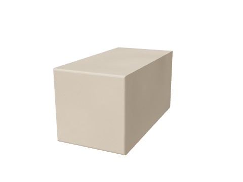<figcaption>游戏构件预览</figcaption></figure>
<figure><figcaption>程序材质表面 · 渲染快照</figcaption></figure>

表面由程序材质生成，没有独立图片贴图；上图展示实际纹理与光泽。

| 形态 | 支持方向 / 旋转 | 实际宽×高（格） |
| --- | --- | --- |
| 整砖 | 标准 | 1×1 |
| 半砖 | 下、上、左、右 | 1×0.5 / 0.5×1 |
| 四分之一砖 | 左下、右下、左上、右上 | 0.5×0.5 |
| 整格坡 | 右下、左下、右上、左上 | 1×1 |
| 缓坡低段 | 右升、左升；0°、90°、180°、270° | 1×0.5 / 0.5×1 |
| 缓坡高段 | 右升、左升；0°、90°、180°、270° | 1×1 |
| 双斜尖顶 | 0°、90°、180°、270° | 1×0.5 / 0.5×1 |

**深度：**2 / 加深 3 格。实心；按实际轮廓组合；加深禁止整父格背景墙。

### 草地土块

<figure>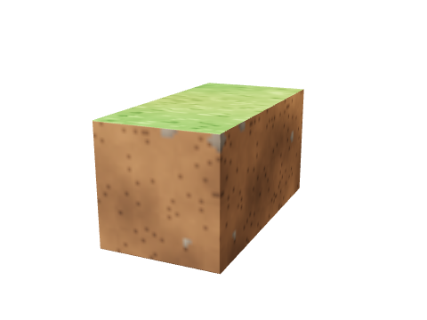<figcaption>游戏构件预览</figcaption></figure>
<figure class="material-texture">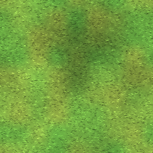<figcaption>顶部色彩图 · 程序生成</figcaption></figure>
<figure class="material-texture">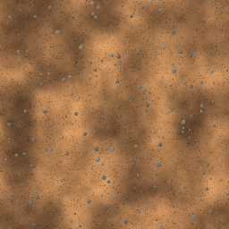<figcaption>侧面色彩图 · 程序生成</figcaption></figure>

以上色彩图直接导出自游戏纹理，一张覆盖 8×8 格，非单格截图；光照与阴影在场景中实时计算。

| 形态 | 支持方向 / 旋转 | 实际宽×高（格） |
| --- | --- | --- |
| 整砖 | 标准 | 1×1 |
| 半砖 | 下、上、左、右 | 1×0.5 / 0.5×1 |
| 四分之一砖 | 左下、右下、左上、右上 | 0.5×0.5 |
| 整格坡 | 右下、左下、右上、左上 | 1×1 |
| 缓坡低段 | 右升、左升；0°、90°、180°、270° | 1×0.5 / 0.5×1 |
| 缓坡高段 | 右升、左升；0°、90°、180°、270° | 1×1 |
| 双斜尖顶 | 0°、90°、180°、270° | 1×0.5 / 0.5×1 |

**深度：**2 / 加深 3 格。实心；按实际轮廓组合；加深禁止整父格背景墙。

### 泥土块

<figure>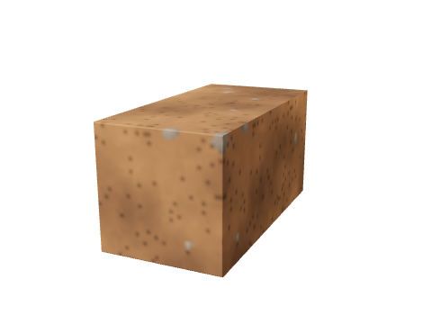<figcaption>游戏构件预览</figcaption></figure>
<figure class="material-texture"><figcaption>色彩图 · 程序生成</figcaption></figure>

以上色彩图直接导出自游戏纹理，一张覆盖 8×8 格，非单格截图；光照与阴影在场景中实时计算。

| 形态 | 支持方向 / 旋转 | 实际宽×高（格） |
| --- | --- | --- |
| 整砖 | 标准 | 1×1 |
| 半砖 | 下、上、左、右 | 1×0.5 / 0.5×1 |
| 四分之一砖 | 左下、右下、左上、右上 | 0.5×0.5 |
| 整格坡 | 右下、左下、右上、左上 | 1×1 |
| 缓坡低段 | 右升、左升；0°、90°、180°、270° | 1×0.5 / 0.5×1 |
| 缓坡高段 | 右升、左升；0°、90°、180°、270° | 1×1 |
| 双斜尖顶 | 0°、90°、180°、270° | 1×0.5 / 0.5×1 |

**深度：**2 / 加深 3 格。实心；按实际轮廓组合；加深禁止整父格背景墙。

### 石块

<figure>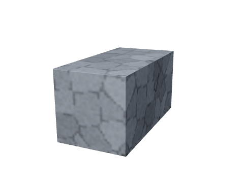<figcaption>游戏构件预览</figcaption></figure>
<figure class="material-texture">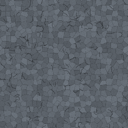<figcaption>色彩图 · 程序生成</figcaption></figure>

以上色彩图直接导出自游戏纹理，一张覆盖 8×8 格，非单格截图；光照与阴影在场景中实时计算。

| 形态 | 支持方向 / 旋转 | 实际宽×高（格） |
| --- | --- | --- |
| 整砖 | 标准 | 1×1 |
| 半砖 | 下、上、左、右 | 1×0.5 / 0.5×1 |
| 四分之一砖 | 左下、右下、左上、右上 | 0.5×0.5 |
| 整格坡 | 右下、左下、右上、左上 | 1×1 |
| 缓坡低段 | 右升、左升；0°、90°、180°、270° | 1×0.5 / 0.5×1 |
| 缓坡高段 | 右升、左升；0°、90°、180°、270° | 1×1 |
| 双斜尖顶 | 0°、90°、180°、270° | 1×0.5 / 0.5×1 |

**深度：**2 / 加深 3 格。实心；按实际轮廓组合；加深禁止整父格背景墙。

### 沙块

<figure>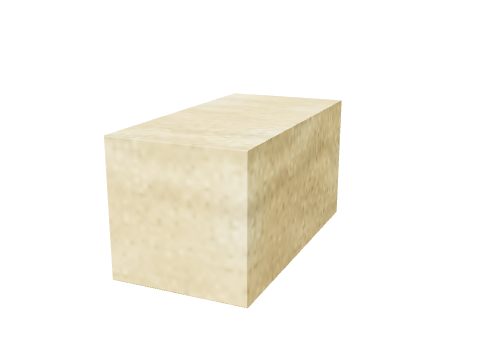<figcaption>游戏构件预览</figcaption></figure>
<figure class="material-texture">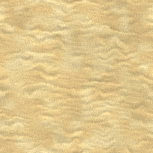<figcaption>色彩图 · 程序生成</figcaption></figure>

以上色彩图直接导出自游戏纹理，一张覆盖 8×8 格，非单格截图；光照与阴影在场景中实时计算。

| 形态 | 支持方向 / 旋转 | 实际宽×高（格） |
| --- | --- | --- |
| 整砖 | 标准 | 1×1 |
| 半砖 | 下、上、左、右 | 1×0.5 / 0.5×1 |
| 四分之一砖 | 左下、右下、左上、右上 | 0.5×0.5 |
| 整格坡 | 右下、左下、右上、左上 | 1×1 |
| 缓坡低段 | 右升、左升；0°、90°、180°、270° | 1×0.5 / 0.5×1 |
| 缓坡高段 | 右升、左升；0°、90°、180°、270° | 1×1 |
| 双斜尖顶 | 0°、90°、180°、270° | 1×0.5 / 0.5×1 |

**深度：**2 / 加深 3 格。实心；按实际轮廓组合；加深禁止整父格背景墙。

### 砂岩块

<figure>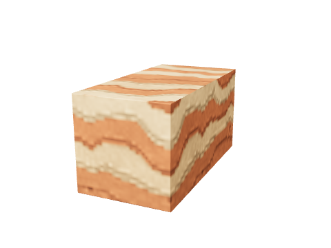<figcaption>游戏构件预览</figcaption></figure>
<figure class="material-texture">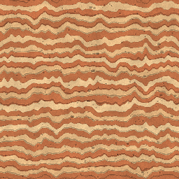<figcaption>色彩图 · 程序生成</figcaption></figure>

以上色彩图直接导出自游戏纹理，一张覆盖 8×8 格，非单格截图；光照与阴影在场景中实时计算。

| 形态 | 支持方向 / 旋转 | 实际宽×高（格） |
| --- | --- | --- |
| 整砖 | 标准 | 1×1 |
| 半砖 | 下、上、左、右 | 1×0.5 / 0.5×1 |
| 四分之一砖 | 左下、右下、左上、右上 | 0.5×0.5 |
| 整格坡 | 右下、左下、右上、左上 | 1×1 |
| 缓坡低段 | 右升、左升；0°、90°、180°、270° | 1×0.5 / 0.5×1 |
| 缓坡高段 | 右升、左升；0°、90°、180°、270° | 1×1 |
| 双斜尖顶 | 0°、90°、180°、270° | 1×0.5 / 0.5×1 |

**深度：**2 / 加深 3 格。实心；按实际轮廓组合；加深禁止整父格背景墙。

### 木料块

<figure>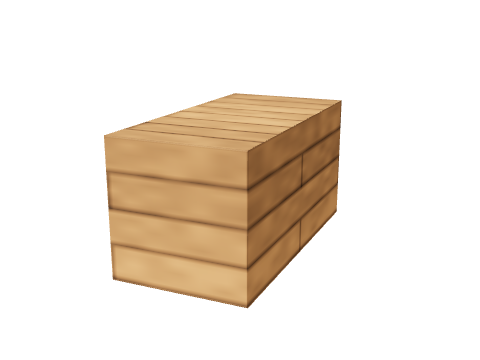<figcaption>游戏构件预览</figcaption></figure>
<figure class="material-texture">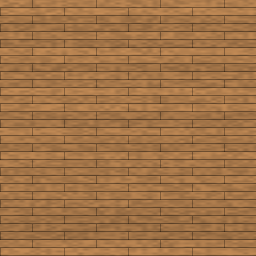<figcaption>色彩图 · 程序生成</figcaption></figure>

以上色彩图直接导出自游戏纹理，一张覆盖 8×8 格，非单格截图；光照与阴影在场景中实时计算。

| 形态 | 支持方向 / 旋转 | 实际宽×高（格） |
| --- | --- | --- |
| 整砖 | 标准 | 1×1 |
| 半砖 | 下、上、左、右 | 1×0.5 / 0.5×1 |
| 四分之一砖 | 左下、右下、左上、右上 | 0.5×0.5 |
| 整格坡 | 右下、左下、右上、左上 | 1×1 |
| 缓坡低段 | 右升、左升；0°、90°、180°、270° | 1×0.5 / 0.5×1 |
| 缓坡高段 | 右升、左升；0°、90°、180°、270° | 1×1 |
| 双斜尖顶 | 0°、90°、180°、270° | 1×0.5 / 0.5×1 |

**深度：**2 / 加深 3 格。实心；按实际轮廓组合；加深禁止整父格背景墙。

## 墙

### 暖白岩板墙

<figure><figcaption>游戏构件预览</figcaption></figure>
<figure><figcaption>程序材质表面 · 渲染快照</figcaption></figure>

表面由程序材质生成，没有独立图片贴图；上图展示实际纹理与光泽。

| 形态 | 登记占位（宽×高，格） |
| --- | --- |
| 标准 | 1×1 |
| 上半 | 1×1 |
| 下半 | 1×1 |
| 左半 | 1×1 |
| 右半 | 1×1 |
| 左下三角 | 1×1 |
| 右下三角 | 1×1 |
| 左上三角 | 1×1 |
| 右上三角 | 1×1 |

**深度：**0.2 格。背景层；不承托；禁止与加深格同格。

## 窗

### 深蓝合金窗

<figure>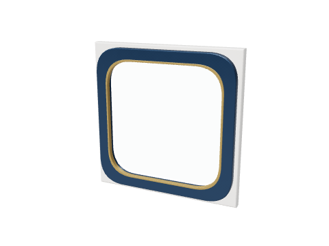<figcaption>游戏构件预览</figcaption></figure>

材质由模型组合，预览直接来自游戏构件。

| 形态 | 登记占位（宽×高，格） |
| --- | --- |
| 2×2 | 2×2 |
| 3×2 | 3×2 |
| 4×3 | 4×3 |

**深度：**[0.2（墙窗标准）](wall-window-definitions.md) 格。背景层跨格占位；不承托；占位范围禁止加深格。

## 门

### 深蓝合金能量门

<figure>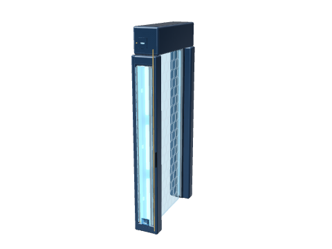<figcaption>游戏构件预览</figcaption></figure>

材质由模型组合，预览直接来自游戏构件。

| 形态 | 登记占位（宽×高，格） |
| --- | --- |
| 左侧 | 1×4 |
| 右侧 | 1×4 |

**深度：**[2（门框占位）](door-definitions.md) 格。自动感应开关；保留门洞；关闭屏障阻挡人物；能量粒子不扩大占格。

## 平台

### 深蓝合金平台

<figure>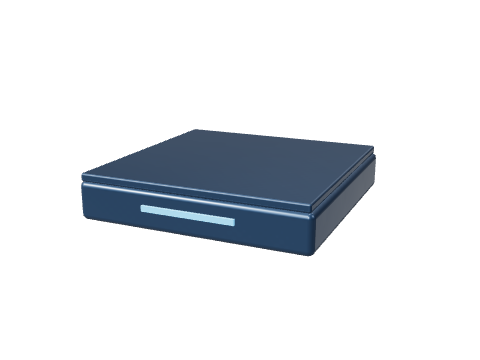<figcaption>游戏构件预览</figcaption></figure>

材质由模型组合，预览直接来自游戏构件。

| 形态 | 登记占位（宽×高，格） |
| --- | --- |
| 整宽 | 1×0.5 |
| 左半 | 1×0.5 |
| 右半 | 1×0.5 |

**深度：**无墙 1 / 有墙 1.5 格。单向承托；顶面=安装 y+0.5；可半格安装；宽度与材质分别选择。

### 暖白岩板平台

<figure>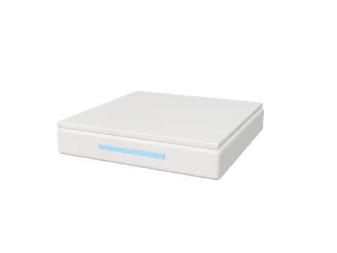<figcaption>游戏构件预览</figcaption></figure>

材质由模型组合，预览直接来自游戏构件。

| 形态 | 登记占位（宽×高，格） |
| --- | --- |
| 整宽 | 1×0.5 |
| 左半 | 1×0.5 |
| 右半 | 1×0.5 |

**深度：**无墙 1 / 有墙 1.5 格。单向承托；顶面=安装 y+0.5；可半格安装；宽度与材质分别选择。

## 家具

### 蓝白合金床

<figure>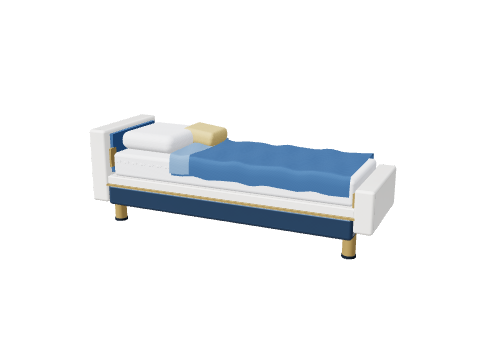<figcaption>游戏构件预览</figcaption></figure>

材质由模型组合，预览直接来自游戏构件。

| 形态 | 登记占位（宽×高，格） |
| --- | --- |
| 标准 | 3×1 |

**深度：**1（标准占位） 格。整件摆放和拆除；承托顶面=安装 y+0.85。

### 蓝白合金全息工作台

<figure><figcaption>游戏构件预览</figcaption></figure>

材质由模型组合，预览直接来自游戏构件。

| 形态 | 登记占位（宽×高，格） |
| --- | --- |
| 标准 | 2×3 |

**深度：**1（标准占位） 格。整件摆放和拆除；承托顶面=安装 y+1.49。

### 蓝白合金储物柜

<figure>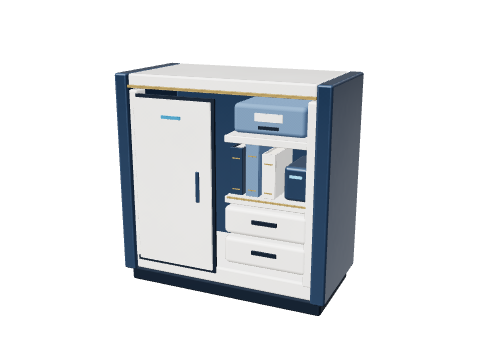<figcaption>游戏构件预览</figcaption></figure>

材质由模型组合，预览直接来自游戏构件。

| 形态 | 登记占位（宽×高，格） |
| --- | --- |
| 标准 | 2×2 |

**深度：**1（标准占位） 格。整件摆放和拆除；承托顶面=安装 y+2。

### 蓝白合金桌

<figure>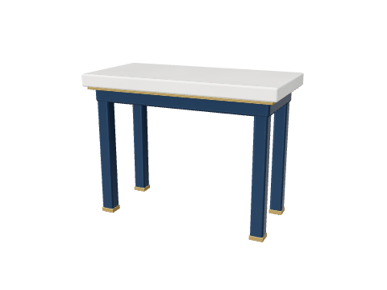<figcaption>游戏构件预览</figcaption></figure>

材质由模型组合，预览直接来自游戏构件。

| 形态 | 登记占位（宽×高，格） |
| --- | --- |
| 标准 | 2×2 |

**深度：**1（标准占位） 格。整件摆放和拆除；承托顶面=安装 y+1.5。

### 蓝白合金软垫椅

<figure>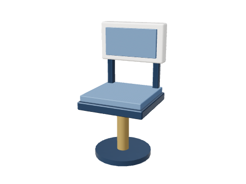<figcaption>游戏构件预览</figcaption></figure>

材质由模型组合，预览直接来自游戏构件。

| 形态 | 登记占位（宽×高，格） |
| --- | --- |
| 正向 | 1×2 |
| 朝左 | 1×2 |
| 朝右 | 1×2 |

**深度：**1（标准占位） 格。整件摆放和拆除；承托顶面=安装 y+1。

### 蓝白合金置物架

<figure>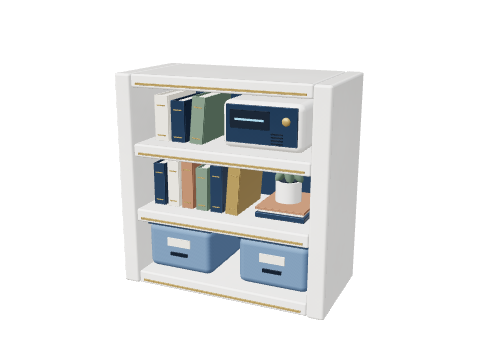<figcaption>游戏构件预览</figcaption></figure>

材质由模型组合，预览直接来自游戏构件。

| 形态 | 登记占位（宽×高，格） |
| --- | --- |
| 标准 | 2×2 |

**深度：**1（标准占位） 格。整件摆放和拆除；承托顶面=安装 y+2。

## 功能设备

### 蓝白合金机器人充电坞

<figure>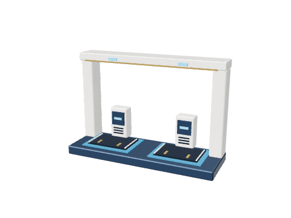<figcaption>游戏构件预览</figcaption></figure>

材质由模型组合，预览直接来自游戏构件。

| 形态 | 登记占位（宽×高，格） |
| --- | --- |
| 标准 | 3×2 |

**深度：**1（标准占位） 格。整件摆放和拆除；不提供承托顶面。

### 蓝白合金蓄电池柜

<figure>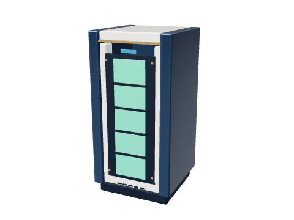<figcaption>游戏构件预览</figcaption></figure>

材质由模型组合，预览直接来自游戏构件。

| 形态 | 登记占位（宽×高，格） |
| --- | --- |
| 标准 | 1×2 |

**深度：**1（标准占位） 格。整件摆放和拆除；承托顶面=安装 y+2。

### 蓝白合金算力终端

<figure>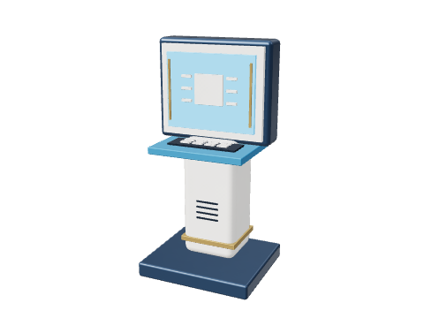<figcaption>游戏构件预览</figcaption></figure>

材质由模型组合，预览直接来自游戏构件。

| 形态 | 登记占位（宽×高，格） |
| --- | --- |
| 标准 | 1×2 |

**深度：**1（标准占位） 格。整件摆放和拆除；不提供承托顶面。

### 蓝白合金机器人终端

<figure>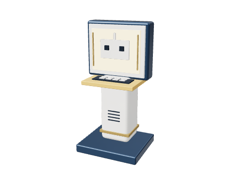<figcaption>游戏构件预览</figcaption></figure>

材质由模型组合，预览直接来自游戏构件。

| 形态 | 登记占位（宽×高，格） |
| --- | --- |
| 标准 | 1×2 |

**深度：**1（标准占位） 格。整件摆放和拆除；不提供承托顶面。

### 太阳能板

<figure>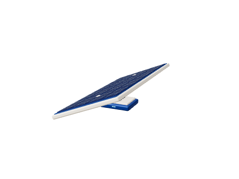<figcaption>游戏构件预览</figcaption></figure>

材质由模型组合，预览直接来自游戏构件。

| 形态 | 登记占位（宽×高，格） |
| --- | --- |
| 标准 | 1×0.5 |

**深度：**2（居中） 格。整件摆放和拆除；不提供承托顶面。

### 深蓝合金能源柱

<figure>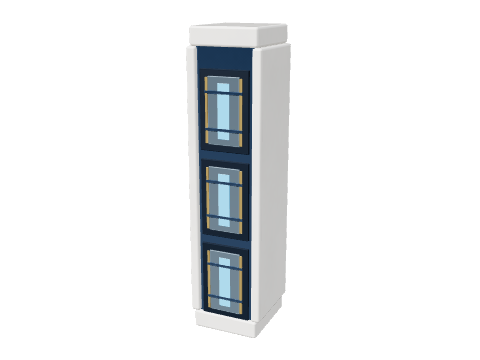<figcaption>游戏构件预览</figcaption></figure>

材质由模型组合，预览直接来自游戏构件。

| 形态 | 登记占位（宽×高，格） |
| --- | --- |
| 标准 | 1×4 |

**深度：**1（模型包络） 格。整件摆放与拆除；装饰不新增实体承托。

## 植物与盆栽

### 阔叶绿植盆栽

<figure>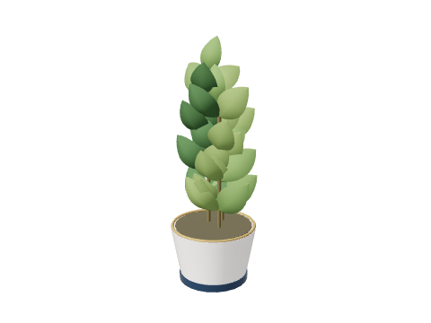<figcaption>游戏构件预览</figcaption></figure>

材质由模型组合，预览直接来自游戏构件。

| 形态 | 登记占位（宽×高，格） |
| --- | --- |
| 标准 | 1×2 |

**深度：**1（标准占位） 格。整件摆放和拆除；不提供承托顶面。

### 暖白岩板花槽

<figure>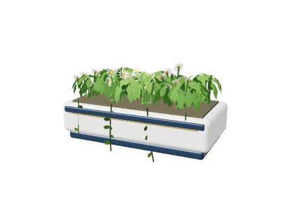<figcaption>游戏构件预览</figcaption></figure>

材质由模型组合，预览直接来自游戏构件。

| 形态 | 登记占位（宽×高，格） |
| --- | --- |
| 标准 | 2×1 |

**深度：**1.0972（模型包络） 格。整件摆放与拆除；包络包含叶片；不新增实体承托。

## 灯具

### 蓝白合金悬吊灯

<figure>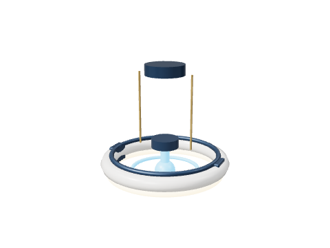<figcaption>游戏构件预览</figcaption></figure>

材质由模型组合，预览直接来自游戏构件。

| 形态 | 登记占位（宽×高，格） |
| --- | --- |
| 标准 | 1×1 |

**深度：**1（标准占位） 格。整件摆放和拆除；不提供承托顶面；照明半径 8 格，灯色 #ffdfb7。

### 蓝白合金檐底灯

<figure>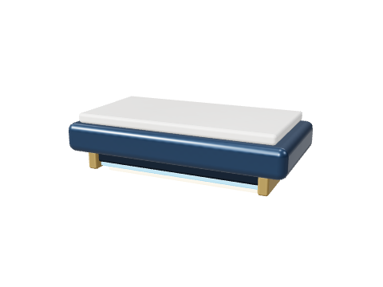<figcaption>游戏构件预览</figcaption></figure>

材质由模型组合，预览直接来自游戏构件。

| 形态 | 登记占位（宽×高，格） |
| --- | --- |
| 标准 | 1×0.5 |

**深度：**0.52（模型包络） 格。整件摆放与拆除；装饰不新增实体承托；照明半径 7 格，灯色 #ffdfb7。

### 蓝白合金壁灯

<figure>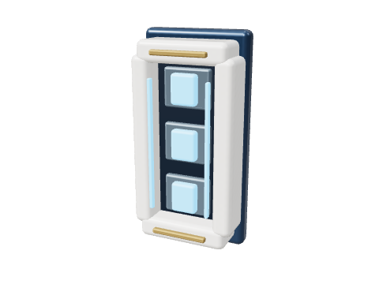<figcaption>游戏构件预览</figcaption></figure>

材质由模型组合，预览直接来自游戏构件。

| 形态 | 登记占位（宽×高，格） |
| --- | --- |
| 标准 | 0.5×1 |

**深度：**0.266（模型包络） 格。整件摆放与拆除；装饰不新增实体承托；照明半径 6 格，灯色 #79cfff。

### 蓝白合金庭院短灯

<figure>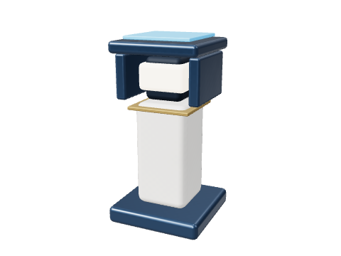<figcaption>游戏构件预览</figcaption></figure>

材质由模型组合，预览直接来自游戏构件。

| 形态 | 登记占位（宽×高，格） |
| --- | --- |
| 标准 | 0.5×1 |

**深度：**0.5（模型包络） 格。整件摆放与拆除；装饰不新增实体承托；照明半径 4.5 格，灯色 #ffead4。

## 建筑装饰

### 深蓝合金直线收边

<figure>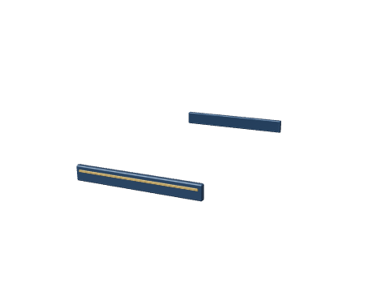<figcaption>游戏构件预览</figcaption></figure>

材质由模型组合，预览直接来自游戏构件。

| 形态 | 登记占位（宽×高，格） |
| --- | --- |
| 标准 | 1×0.5 |

**深度：**1.996（模型包络） 格。整件摆放与拆除；收边依附和拆支撑限制先记录，暂未强制，开放规则后续决定。

### 深蓝合金转角收边

<figure>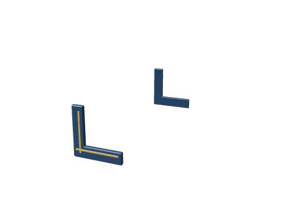<figcaption>游戏构件预览</figcaption></figure>

材质由模型组合，预览直接来自游戏构件。

| 形态 | 登记占位（宽×高，格） |
| --- | --- |
| 标准 | 0.5×0.5 |

**深度：**1.996（模型包络） 格。整件摆放与拆除；收边依附和拆支撑限制先记录，暂未强制，开放规则后续决定。

### 深蓝合金端头收边

<figure>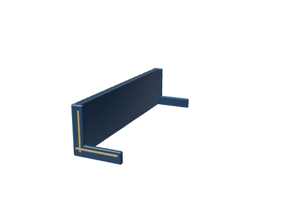<figcaption>游戏构件预览</figcaption></figure>

材质由模型组合，预览直接来自游戏构件。

| 形态 | 登记占位（宽×高，格） |
| --- | --- |
| 标准 | 0.5×0.5 |

**深度：**1.996（模型包络） 格。整件摆放与拆除；收边依附和拆支撑限制先记录，暂未强制，开放规则后续决定。

### 深蓝合金栏杆

<figure>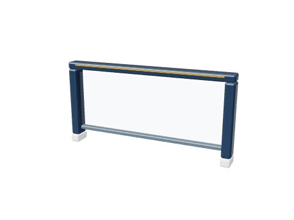<figcaption>游戏构件预览</figcaption></figure>

材质由模型组合，预览直接来自游戏构件。

| 形态 | 登记占位（宽×高，格） |
| --- | --- |
| 标准 | 2×1 |

**深度：**0.2（模型包络） 格。整件摆放与拆除；装饰不新增实体承托。

## 实体形状

各材料表中仅列当前支持的形态。精确轮廓、旋转方向和组合规则见[格子形态与支持范围定义](tile-shape-definitions.md)，普通 / 加深的前后范围见[深度定义](depth-definitions.md)。

## 环境与特殊瓦片

| 对象 | 用途 | 玩家编辑 |
| --- | --- | --- |
| 远景城市、天空、太阳、星空 | 世界环境 | 不作为建筑材料 |
| 无人机、列车 | 环境交通动画 | 不作为建筑格子 |
| 河流、水面、睡莲 | 环境水体与植物 | 本轮不开放为建造构件 |
| 背景树、草花、灌木 | 游戏植物工厂生成环境 | 盆栽与花槽可建造；背景植被另管 |
| 空气 | 空瓦片标识 | 清理产生，不是材料 |
| 树枝承托面 | 树木生成的单向碰撞 | 不单独建造 |
| 渔屋屋顶瓦片 | 屋顶模型配套碰撞 | 建造屋顶使用已登记材料与坡形 |
| 旧游戏平台瓦片 | 世界单向碰撞类型 | 建造目录使用上表正式平台构件 |

## 当前能力与后续边界

- 四小块、互补斜块、半宽平台按实际轮廓组合与编辑；加深与整格背景墙双向互斥。米黄色方石两格合缝保留逐格选取、替换与拆除。
- 住宅地台使用可编辑方石，平台承托随实际宽度和顶面变化；自由搭建目录包含全部已登记资源。
- 暖白岩板、方石和合金使用共享材质，细微纹理固定在世界坐标，反光与阴影随实际光照变化；不把单张静态参考图当成所有天气下的固定颜色。
- 收边依附、拆支撑后的装饰处理，以及坡面和加深格收边的开放范围暂未强制，按用户要求留待后续决定。
- 自然光只经天空、挖通的开口、门与地上窗进入。窗代表后墙开口；低于基础顶面（y=1）的地下窗背后是地质实体，不产生天空光。地上密闭空间不按高度获得天光。
- 灯具照明有半径上限，沿空气绕拐角传播并随路径长度变暗；灯光与天空漫射光渗入实心构件后迅速衰减，约 2～3 格归零，1 格薄墙另一侧透出微光，2 格以上另一侧基本全黑；太阳直射仍被实心完全遮挡；每盏灯都照亮周围，与镜头位置无关。能量门、全息、能源柱只自发光，不照亮周围。
- 精细高光只由镜头附近少量灯提供：高画质 4 盏，低画质 2 盏。
- 家具坐卧动画尚未制作；拆平台时家具支撑依赖的级联处理尚未接入，跨格支撑与物品返还规则待定。

尺寸登记、规则实现与动画制作分别记录，不把已完成的资源接入误写成“整体尚未制作”，也不把这些后续能力标记为已实现。
