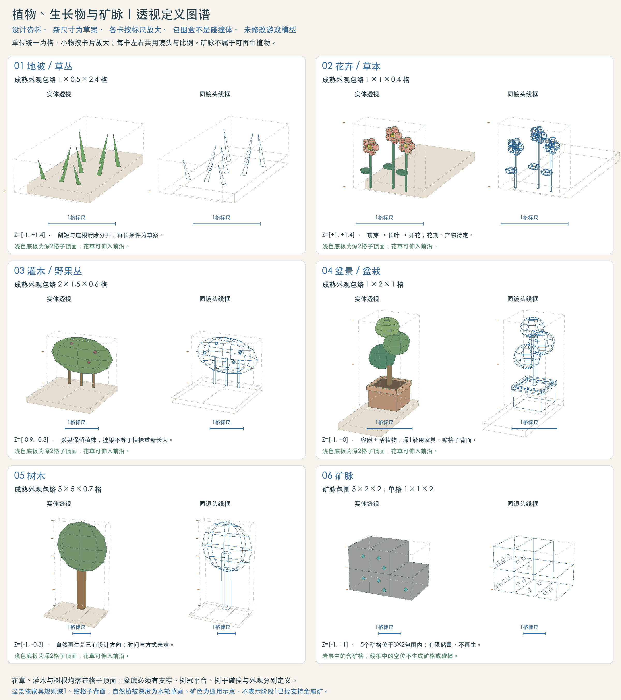
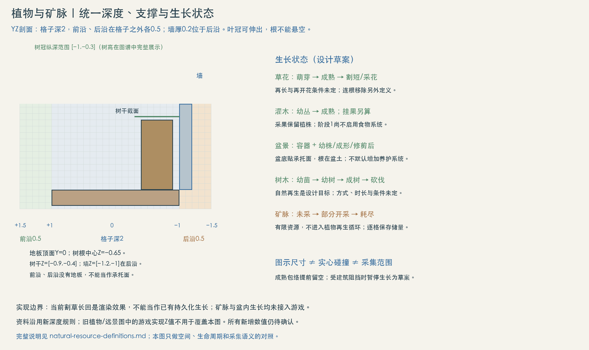

# 植物、生长物与矿脉定义

状态：草案（2026-10-10）。补充的设计资料与透视示意，不代表游戏已实现。覆盖地被草丛、花卉、灌木、盆景、树木、藤蔓和矿脉。新增尺寸、占位及状态转换均为草案；深度按2026-10-11新定义：格子深2、格子之外前沿与后沿各0.5、墙厚0.2位于后沿，以及家具盆栽深1。经济设定已有“树木自然重新生长、矿点有限”，但不把完整经济草案全部纳入阶段1。

## 空间位置优先

先看[附着物、前沿、树木占格与矿脉空间定义](natural-spatial-definitions.md)：组合透视图明确宿主格、附着位置和开采后的围岩。本节成熟总览只作形体参考；草花Z位置与矿脉宿主关系按新版空间定义。

## 各类独立状态定义与透视图

本轮整理六类基础植物33个状态，沿边、容器与树冠下垂变体21个状态，底面悬垂另有4个状态，植物共58个状态；矿脉另有3个状态，各有独立定义。青苔另有四种附着形态，藤蔓另列十二种形态图谱，格子底面另列三种内部附着形态。每类逐状态给出宽、高、深、顶面Y、Z范围、锚点、采集后残留；同类共用镜头与比例。盆景另列土面以上株高，树木另列干宽与干高，矿脉按实际剩余格定义。下方旧总览保留为共同空间规则；各状态的具体数值以对应独立资料的绘图草案为准。

- [地被与草丛：尺寸表与状态透视](natural-grass-definitions.md)
- [花卉与草本：尺寸表与状态透视](natural-flower-definitions.md)
- [灌木与野果丛：尺寸表与状态透视](natural-shrub-definitions.md)
- [盆景与盆栽：尺寸表与状态透视](natural-bonsai-definitions.md)
- [树木：尺寸表与状态透视](natural-tree-definitions.md)
- [藤蔓与贴面植物：正背面覆盖及四阶段透视](natural-vine-definitions.md)
- [下垂植物：六种形态、附着点与垂直落差](natural-drooping-definitions.md)
- [矿脉：尺寸表与状态透视](natural-ore-definitions.md)
- [岩石：土中嵌岩、空岛底岩、含矿组合与独立石块](natural-rock-definitions.md)（土内嵌岩由泥土包围；空岛岩脊埋入顶部泥土，向下连续出露并收尖。土与岩同深2、前后面齐平，碰撞按实际组合轮廓；空间补充，不计入上述植物与矿脉状态数）

## 1. 分类与透视尺寸

尺寸顺序为宽X×高Y×深Z，单位为格。植物尺寸是成熟外观包络；根部占位、碰撞和采集范围单独定义。小草底层覆盖整格顶面，高叶之间保留空隙，不形成实心草方块；树冠跨格不等于整片树冠都是实心地形。

| 类型 | 图示成熟宽×高×深 | 锚点与支撑 | 图示Z范围 | 生长与资源属性 |
| --- | --- | --- | --- | --- |
| 地被 / 草丛 | 1×0.5×2.4 | 根层覆盖整格1×2顶面，前缘叶另伸0.4 | −1～+1.4 | 自然植被；割断后可再长为草案，不默认产出木材或食物 |
| 花卉 / 草本 | 1×1×0.4 | 根颈贴土壤，随实际坡面落脚；根带贴前上棱Z=+1 | +1～+1.4 | 萌芽、长叶、开花；花期、采花产物与再开花条件待定 |
| 灌木 / 野果丛 | 2×1.5×0.6 | 根部位于宿主顶面靠后；根中心Z=−0.6 | −0.9～−0.3 | 灌木与挂果状态分开；只有指定可食物种产出野果，阶段1食物不启用 |
| 盆景 / 盆栽 | 1×2×1 | 盆底贴地板、桌面或明确的承托面；盆土是植物根部基准；按家具贴格子背面 | −1～0 | 容器与活植物分别定义；容器内生长为新增草案，浇水、施肥和收获系统不自动加入 |
| 树木 | 3.6×5.15×0.7（矮冠树样例，各物种见树木定义） | 图示树干底径0.5；根颈贴土壤，根中心Z=−0.65 | −1～−0.3 | 幼苗、幼树、成树；木材采集与自然重新生长沿用经济设计方向，条件与时长未定 |
| 矿脉 | 单格1×1×2；图示3×2格内5个矿格 | 寄生于可开采实体岩层；无植物根部 | −1～+1 | 连续矿格形成矿脉，储量有限；不随植物生长计时恢复 |

盆景图示盆体主体为0.7×0.45×0.7，含盆沿包络0.76×0.5×0.76，植物与盆体总高2；盆口土面Y=0.45为示例，不能把盆体高度和植物总高重复相加。盆景沿用已有家具盆栽的1×2×1包络，植物叶片不必填满深1。自然植被不套用家具深1的规则。

图谱中的尺寸用于建立初始美术尺度，不限制所有物种只能长成同一大小。树高5、冠宽3、树干0.4都是样例；不新增物种清单、数值平衡或参数化编辑器需求。

## 2. 空间、深度与支撑

格子为Z=[−1,+1]，前沿为[+1,+1.5]，后沿为[−1.5,−1]，前沿、后沿在格子之外。墙厚0.2，位于后沿[−1.2,−1]，紧贴格子背面。所有图共用世界单位与透视方向；图谱中的小物按卡片放大，每卡实体与线框共用相机和比例，按各卡1格标尺读图。斜上方镜头仅用于看清纵深，不改变XY二维玩法。

根部或盆底必须有真实承托面。草花与附着植物的枝叶可以伸入前沿；树木和灌木采用后置范围。前沿、后沿只是空间，不会自动生成土壤或地板。小草根层覆盖整格顶面，前缘叶片向前沿伸出；花卉根皮进入砖前上棱表皮0.02；灌木和树在宿主顶面靠后扎根，灌木根中心Z=−0.6、树根中心Z=−0.65。与家具贴格子背面的方向一致，两类植物整株位于Z≤−0.3，在人物身体区[−0.3,+0.3]之后（core-coordinates.md 第 3 节，待实测），树干、冠叶、垂枝与果实均不得越过；草不用后退，仍覆盖完整顶面。成熟树冠后界−1即格子背面，与墙零交集；成熟灌木冠Z=[−0.9,−0.3]。运行时模型和碰撞未改。前沿由附着结构使用，不凭空铺成地板。若要整盆放进前沿或后沿，必须另定容器尺寸与承托结构；现有深1的盆景不能塞进深0.5的前沿或后沿。

成熟包络用于检查墙、屋顶、相邻植物及通口的净空，不把幼苗当前小体积当作最终占位。新建结构与后续生长发生冲突时，草案采用暂停生长并显示原因；不允许靠生长穿墙或删掉建筑解决。本轮空间图中，树根宿主被挖除则移除对应植株，不能留下悬空的树；倒伏动画与掉落另定。

## 3. 生长与采集状态

| 对象 | 最少表现状态（草案） | 采集后的含义 |
| --- | --- | --- |
| 草丛 | 萌芽 → 茂盛 → 割短 → 再长 | 根仍在才有原位再长的候选条件；连根清除与割草必须区分 |
| 花卉 | 萌芽 → 长叶 → 开花 | 摘花与移除整株不是同一操作；产物、再开花和枯萎规则待定 |
| 灌木 | 幼丛 → 成熟；可食物种另有挂果 / 已采果 | 采果保留植株，砍丛移除地上枝条；果实恢复与植株再生分开 |
| 盆景 | 容器存在 + 植株幼株 / 成形 / 修剪后 | 搬动整盆保留植株状态；打碎盆、拔除和修剪的玩法与产物待定 |
| 树木 | 幼苗 → 幼树 → 成树 → 已砍伐 / 树桩 | 自然再生已有设计方向；树桩萌发或重新生成幼苗的方式、触发条件、时长待定，图中树桩只是候选表现 |
| 矿脉 | 未开采 → 部分开采 → 耗尽 | 保存剩余储量，耗尽不自然恢复；开采地形矿格后留下对应洞格，不让表面纹理继续显示为可采矿 |

植物摇摆、季节颜色和割草视觉恢复不等于持久化生长。生长若进入玩法，应使用游戏时间并保存阶段与进度；切换镜头、卸载区块或读档不能把成树变回幼苗，或把采到一半的树与矿点恢复满产。具体速度、光照/水分阈值、种子掉落和离线生长均未确定。

## 4. 矿脉的格子定义

本轮草案将矿脉定义为实体岩层中一组上下左右连通的矿格。每格独立记录矿种及剩余储量；整条矿脉的轮廓不生成一个覆盖空洞的大碰撞盒。矿格仍使用宿主地形的实体碰撞，开采完成才按地形挖除规则处理对应格；不叠加第二份可采实体。图示5个完整矿格排在3×2包围中，第六格为非矿石格；旧图省略围岩并不表示该处必然是空气。完整空间方案采用20格岩层中5个矿格，耗尽后仍保留15格围岩。

矿色、晶体和裂纹是矿种及采集状态的外观，不以发光亮度代替储量。矿色嵌入岩石表面，图中没有把矿脉画成地面上会生长的盆栽。半砖/斜坡中的矿物表现应沿宿主轮廓裁切，不默认补成整砖；本图仅画整格样例。

铜、硅、铀来自完整经济设定的后续材料，本图使用通用矿色，不新增阶段1金属矿采集要求。露天石块、洞壁装饰晶体和可采矿脉需在目录中标明是否可采，不能只凭外形自动赋予产物。

## 5. 外观、碰撞、交互与记录字段

| 范围 | 定义草案 |
| --- | --- |
| 放置占位 | 自然植物记录根部锚点与成熟包络；盆景记录盆底锚点与承托对象；矿脉记录实际矿格集合 |
| 碰撞与通行 | 草花默认只作视觉；盆体与树干是否阻挡另定，不能从包围盒直接推导。树冠可站立部分单独定义为平台，普通叶片不自动承托角色 |
| 采集与交互 | 使用XY选取范围，Z用于表现；修剪、采果、砍伐、连根移除、搬盆、开采是不同动作，只启用已有玩法需要的动作 |
| 资源状态 | 实例标识、类型/物种、位置与种子、生长阶段/进度、采集剩余量；盆景记录容器与植株关系，矿脉记录各矿格状态 |
| 美术复用 | 同一物种的幼体、成体、采集后状态保持形体与材质关系；未来展示场应直接复用游戏资源，不照此概念图另建一套运行时模型 |

## 6. 范围与待定项

本次只补定义、透视图和线框，未修改游戏生成、模型、碰撞、存档或经济数值。树木自然再生与有限矿点是既有经济设计方向；花草再生、盆内生长、矿格开采结果为本次具体化草案。旧家具资料中的“纯装饰盆栽”保留为旧阶段1方案，生长部分以本节的新草案状态理解，不能声称已经做出种植系统。

待定：新增物种对本页样例尺寸的扩展、自然分布与间距、生长时间与环境条件、树木再生方式、盆景维护玩法、矿种与单格储量、树干及盆体碰撞、采集产物。尺寸与交互定稿后再接入运行时；本轮不为这些未定项设默认数值。

依据：public/concepts/depth-definitions.md、public/concepts/furniture-definitions.md、public/concepts/economy.md。旧“植物与远景”图记录当前实现的Z范围，本节使用新的深度设计口径，两者不能混作已经统一的游戏参数。

## 透视图与交互演示

[先看：青苔、前沿、树木占格与矿脉岩层透视 →](../?mode=concepts#natural-spatial-definitions)

[地被与草丛](../?mode=concepts#natural-grass-definitions)

[花卉与草本](../?mode=concepts#natural-flower-definitions)

[灌木与野果丛](../?mode=concepts#natural-shrub-definitions)

[盆景与盆栽](../?mode=concepts#natural-bonsai-definitions)

[树木](../?mode=concepts#natural-tree-definitions)

[藤蔓与贴面植物](../?mode=concepts#natural-vine-definitions)

[下垂植物](../?mode=concepts#natural-drooping-definitions)

[岩土地形组合](../?mode=concepts#natural-rock-definitions)

[矿脉](../?mode=concepts#natural-ore-definitions)
