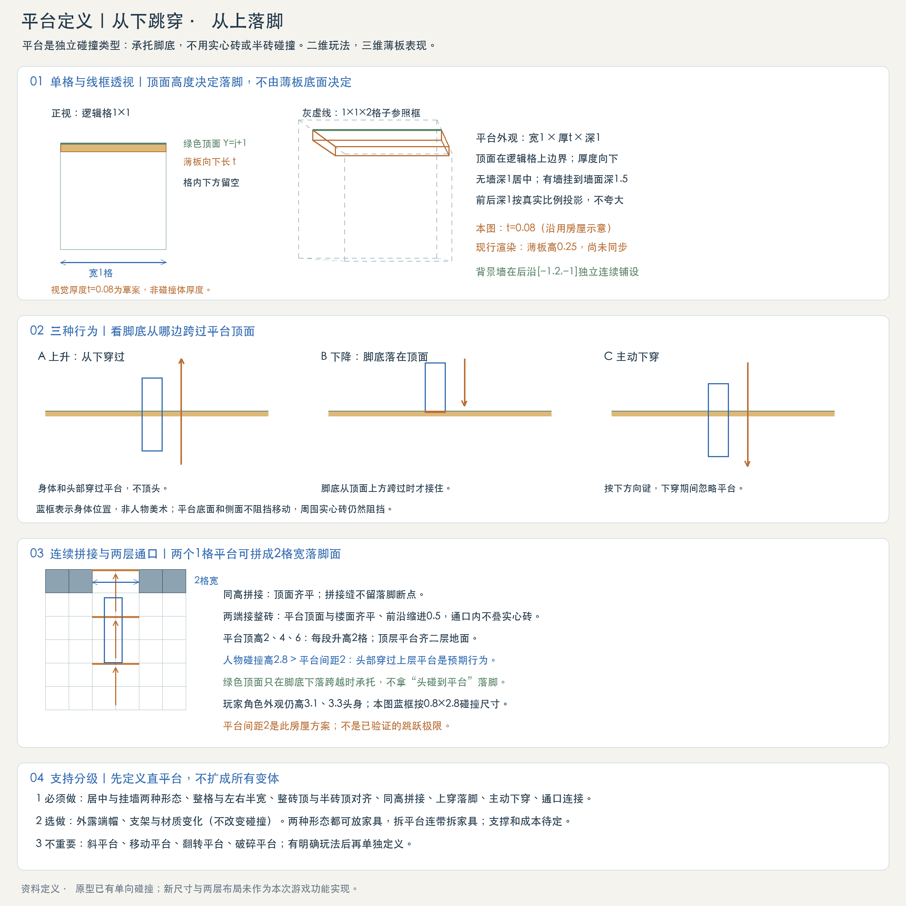
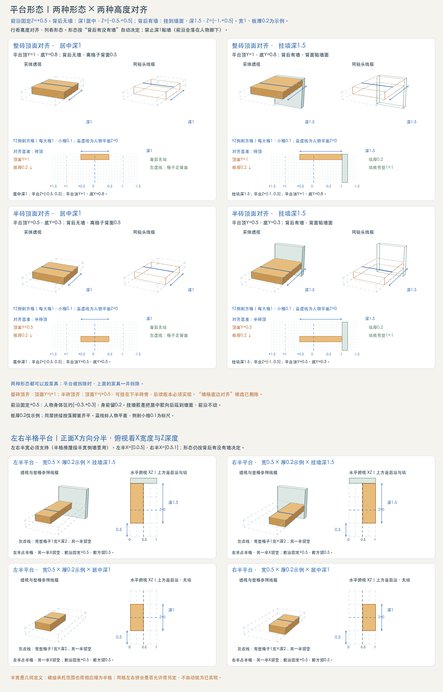
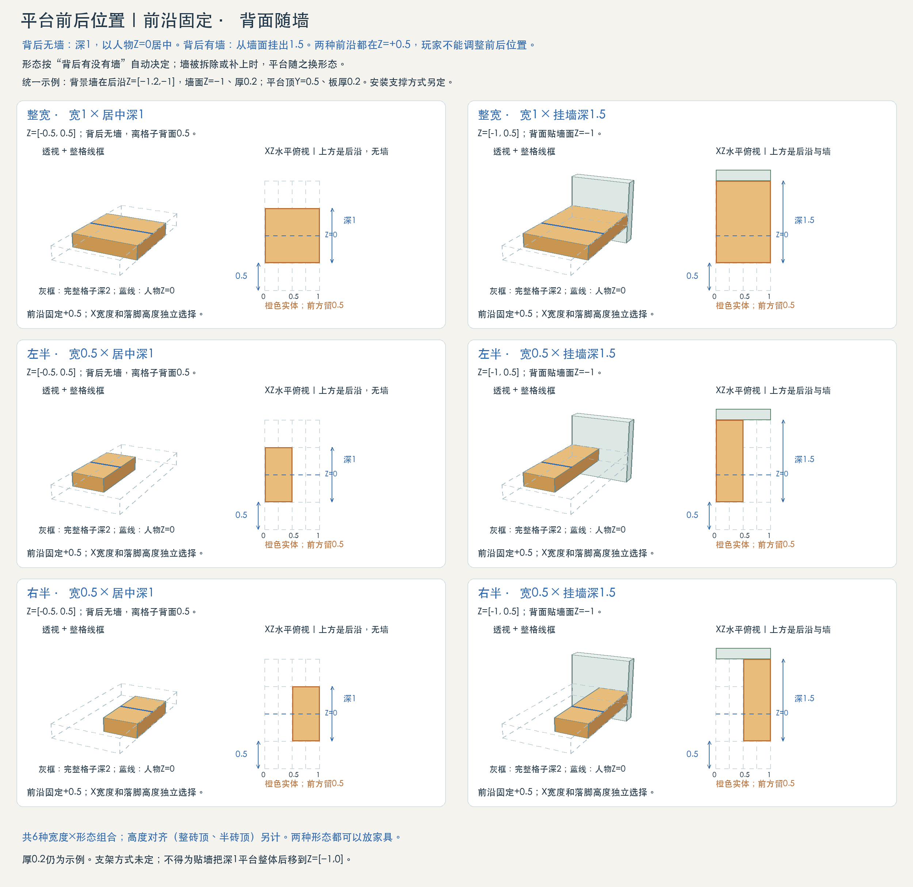

# 平台定义

状态：现行平台规则（2026-10-16 核对共享实现）。暖白岩板平台与深蓝合金平台共用同一套行为，整宽、左右半宽、居中与挂墙、整砖顶齐与半砖顶齐均已接入住宅和自由搭建场。形态和高度是平台属性，不另算材料。上穿、落脚、下穿及半宽同格组合已有行为测试；人物视觉遮挡、具体房屋的跳跃手感按实际场景核对。

## 玩家可见性

平台不能遮住穿越中的玩家头部和身体。透视场景按玩家实际像素轮廓遮去重叠的平台表面与检查格线；未重叠的部分正常显示，实色、半透明及观察视角均适用。平台不向穿越玩家投射遮挡阴影。

这项显示规则不改变平台形态、宽度、顶面高度或单向承托；玩家仍在 Z=0，实体墙和实心砖仍正常遮挡。不能为避免遮脸把玩家前移、缩小，或改换平台形态。

## 1. 平台是什么

平台是只在顶面承托脚底的单向构件。角色从下方起跳时可穿过，下降时脚底从上方跨过顶面才落脚；侧边、底面不作为实心阻挡。实心半砖会阻挡身体，不能拿半砖替代平台。

## 2. 尺寸与占格

**两种形态（2026-10-11 确认）。** 平台前沿固定在Z=+0.5。背后没有背景墙时深1，以人物Z=0居中，Z=[−0.5,+0.5]；背后有背景墙时从墙面挂出1.5，Z=[−1,+0.5]。形态按“背后有没有墙”自动决定，不由玩家选择，以后再看是否调整。深2满格平台取消。

- 单件占一个1×1逻辑格；水平宽可选整格1、左半格0.5或右半格0.5；深度由形态决定，见第7节。前沿、后沿在格子之外各0.5，平台不伸入。
- 逻辑格左下角为(i,j)，整砖顶齐为Y=j+1，半砖顶齐为Y=j+0.5。当前放置坐标按半格吸附，存档安装y加0.5就是实际承托顶面：安装y=j+0.5得到整砖顶齐，安装y=j得到半砖顶齐。X承托范围按第8节的整格、左半格或右半格确定。薄板从顶面向下延伸视觉厚度t，不能把整个格子填成实体。
- 住宅与自由搭建场的共享平台厚度为0.2格，顶部装饰层包含在这0.2格内。旧两层房屋图的0.08，以及旧世界瓦片渲染器的SLAB_HEIGHT=0.25，仅属历史或另一类旧瓦片实现，不作为当前建筑平台规格。
- 碰撞承托面是二维顶线，不是厚t的实心矩形；Z厚度用于三维表现，不新增第三条移动轴。
- 背景墙独立铺在后沿 Z=[−1.2,−1]，可在平台后连续铺设；放置按平台实际宽度及顶面下0.2格的轮廓检查重叠；不得让实体砖穿入平台，空出的半边仍可利用。材料成本和安装支撑要求尚未定稿。

## 3. 通过与落脚规则

1. 上升：不阻挡头部和身体。人物只露出头部时，不能被平台吸到上面。
2. 下落：身体在X方向与平台有重叠，旧脚底在顶面或上方，新脚底下降跨过顶面，且未处于下穿状态，才在顶面落脚。
3. 站立：脚底与顶面齐平；同高相邻平台可以连续行走。离开支撑范围后下落。
4. 主动下穿：沿用现有S/↓输入。站在仅由平台支撑的位置时，暂时忽略平台并向下移动；附近实心砖仍阻挡。现有计时方式不保证一次只穿过一层，本资料不承诺新增此行为。
5. 下方穿越时不能顶头；人物侧身接触平台薄板也不新增墙碰撞。其他实体砖的碰撞规则保持独立。

## 4. 拼接与两层通口

- 两件宽1平台沿X拼成宽2落脚面，顶面高度与前沿一致；中间接缝不留落脚空洞，不增加端帽阻挡。相邻两格一格有墙、一格没墙时，背面深度不同，属正常结果。
- 两端连接实体楼板时，平台顶面与楼面齐平，前沿比楼板正面缩进0.5，用来区分可穿平台与实心楼板；通口所在两格移除实心楼板，不能在可穿平台后仍叠放实心砖。
- 早期房屋示意图采用宽2格通口、平台相对地面高2/4/6格，表示一种摆放方案；当前住宅按自己的楼层净高和布局安装，床和吊灯避开通道。
- 玩家角色外观高3.1，碰撞高2.8，平台间距只有2；站在下层平台时身体可能穿过上层平台，这是平台规则的预期结果，不应因此缩小玩家角色。
- 2格高差属于本房屋摆放方案，不是平台的固定间距，也不是已验证的角色最大跳高。跳跃参数与通行手感需游戏验收。

## 5. 支持优先级

|级别|范围|
|---|---|
|1 必须做|居中与挂墙两种形态、整格与左右半宽、整砖顶与半砖顶对齐、同高连续拼接、上穿落脚、主动下穿、楼板通口连接。这些变化已接入共享平台实现，半宽和半格承托有行为测试；具体场景通行仍按实际布局核对。|
|2 选做|外露端帽、支架、材质外观变化，不改变碰撞规则。|
|3 不重要|斜平台、移动平台、翻转平台、破碎平台，有明确玩法后再定义。|

已登记的暖白岩板和深蓝合金平台均提供整宽、左半、右半三种宽度。实心缓坡组合不属于此处的平台。

## 6. 图与实现依据

概念图：/concepts/platform-definition.png
房屋示例：/concepts/room-two-storey-perspective.png

当前建筑平台：`src/config/residence.ts` 注册两种材料与三种宽度；`src/render/building/definition-kit.ts` 的 platform 工厂生成0.2格厚的实体；`src/sim/residence.ts` 生成实际宽度和顶面的单向承托线；`src/physics/definition-collision.ts` 处理上穿、落脚与下穿。`test/residence.test.ts` 与 `test/building-brush.test.ts` 验证半格承托、空半边不承托、左右半平台同格与清理范围。

旧世界的 `TILE_PLATFORM` 与 `src/render/tile/tile-view.ts` 是世界地形瓦片实现；它的外观参数不能覆盖当前建筑平台标准。

## 7. 两种形态与两种高度对齐（最新规则）

已确认（2026-10-11）：平台只有两种形态，前沿都在Z=+0.5。旧“深1与深2、只许居中、禁止贴墙”的规则废止。宽度包括整格1与左右半格0.5；当前共享建筑平台板厚t=0.2格，与本图相同，不能将“半砖顶面对齐”理解成板厚0.5。

|形态|条件|Z范围|深度|
|---|---|---|---|
|居中|所在格背后没有背景墙|[−0.5,+0.5]|1|
|挂墙|所在格背后有背景墙|[−1,+0.5]|1.5|

形态自动决定：平台所在逻辑格铺了背景墙（含窗框、半墙）就是挂墙款，否则是居中款；玩家不选择，墙被拆除或补上时平台随之换形态。这是当前做法，以后再看是否调整。

前沿规则：人物身体区约[−0.3,+0.3]，前沿+0.5在身体前留0.2。深1贴墙（Z=[−1,0]）仍然禁止，因为前沿正好落在人物平面上，站立时脚部悬出。挂墙款是把居中款向后延到墙面，前沿不动，不是把平台整体后移。

逻辑格底为Y=j，两种高度对照如下：

|高度对齐方式|平台顶面|平台底面（t=0.2示例）|
|---|---|---|
|整砖顶面对齐|j+1|j+0.8|
|半砖顶面对齐|j+0.5|j+0.3|

“墙格底边对齐”候选已删除。上半砖顶面与整砖顶面同高，不新增一种高度。形态、宽度、高度对齐分别决定，图上的例子不是必须逐个制作的独立资产。

**半砖顶齐已实现。** 平台可以放在下半砖旁，实际顶面与下半砖顶面齐平；材料选择不影响承托高度。

碰撞承托线必须跟随实际平台顶面：整砖顶齐为j+1，半砖顶齐为j+0.5。住宅、自由搭建与定义预览均按实际顶面生成承托线，存档保留半格安装坐标。

挂在墙面不等于已定义承重；托架、立柱、悬浮外观及放置支撑要求仍待定。

透视与线框图：/concepts/platform-mount-perspective.png

## 8. 左右半格与水平俯视

左右指游戏正面的X方向，不是前后Z方向。单格原点为X=i：整宽覆盖[i,i+1]；左半平台覆盖[i,i+0.5]；右半覆盖[i+0.5,i+1]。左右半格各宽0.5，另一半留空。形态仍按有无背景墙决定。

**左右半宽平台必须支持（2026-10-11 确认）。** 侧墙只有半格宽的房屋要靠它把平台接到墙边，不能列为选做。

本图有左半×挂墙、右半×挂墙、左半×居中、右半×居中四例，统一板厚0.2、顶高0.5作为绘图示例；不增加新厚度或新高度规则。

每例附实体透视、完整格子的参照线框、等比例XZ水平俯视。俯视图上方为后沿方向，挂墙两例画出墙（完整1×1、厚0.2），居中两例背后无墙；灰框表示完整1格宽，橙色为实际平台，蓝虚线为人物Z=0。半宽不等于半深，也不等于半格高度。

半宽平台的碰撞承托X范围与实际半格一致，空半边不承托。左右半平台可以在同格互补放置，分别保存、选择和拆除；清理空半边不会误删另一侧。平台与其他实体若实际轮廓重叠则拒绝放置。

独立局部图：/concepts/platform-half-plan.png
完整形态图：/concepts/platform-mount-perspective.png

## 9. 前后位置：前沿固定，背面随墙

平台前沿固定在Z=+0.5；整宽、左半、右半均适用。玩家不能调整前后位置。

|形态|Z范围|背面|格子内前方余量|
|---|---|---|---|
|居中，深1|[−0.5,+0.5]|离格子背面0.5，背后无墙|0.5|
|挂墙，深1.5|[−1,+0.5]|贴墙面Z=−1|0.5|

可选组合：3种X占格（整宽、左半、右半）×2种高度对齐=6种；每种按有无墙呈现两种形态，图上共12例。

承重与安装支撑要求仍待定义，托架、吊索、立柱或悬浮外观不能改变前沿位置。当前两种形态按墙存在与否自动切换，人物脚部与场景遮挡效果需在标准游玩镜头下核对。

安装位置透视与水平俯视：/concepts/platform-position-plan.png

## 10. 平台上的家具

- 两种形态都可以放家具，不作限制。家具和放在砖上一样，深1贴格子背面，占Z=[−1,0]：挂墙款完整承托；居中款上家具后半0.5悬在板外，正面游戏镜头下看不出，接受。
- 人物在平台上经过家具，和在砖上一样让到家具前沿+0.5（Z=+0.5），身体中心正好在平台前沿，约一半身体伸出前沿。已确认可以：碰撞按XY二维计算，挂出半个身体不会掉下去。
- 已确认的后续要求是拆平台时处理其上家具；当前拆除仅移除选中的构件，尚未接入家具支撑依赖的级联处理。跨多格家具由哪块支撑触发、是否返还物品仍待定，不把这部分标记为已实现。

## 透视图与交互演示

[查看最新形态 →](../?mode=concepts#platform-mounts)

