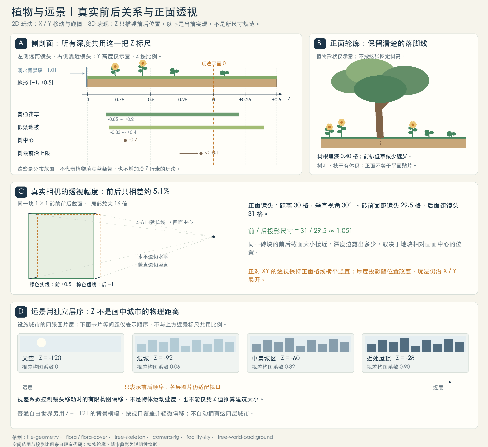

# 场景由哪些部分组成

二维玩法，三维场景：X 是左右移动，Y 是高度与跳跃，Z 是画面的前后纵深。移动、占格与碰撞使用 XY 规则平面；三维模型、地表厚度、植物、光影和透视构成场景表现。玩法平面按 Z=0 对照，不能把 Z 纵深画成可自由走动的第三条移动轴。

[查看新增植物、生长物与矿脉定义及透视图 →](../?mode=concepts#natural-resources)

## 现有游戏的植物与远景：实现坐标参考

本段记录现行游戏从+Z观察的坐标；植物大类的新透视图也已统一为+Z朝镜头，但数值属于新版设计，尚未接入游戏。新方案的尺寸与摆放见[植物空间定义](../?mode=concepts#natural-space)，两套数值不可直接混用。

[打开植物与远景透视概念图 ↗](plants-distant-perspective.png)

当前游戏使用透视相机：默认视角 30°、距离 30 格，从 +Z 平视 Z=0；不是固定俯视或 45° 斜视。同尺寸的独立几何体会近大远小，纵深边随投影收敛，但玩法格子的世界尺寸不变。新版图按正面镜头计算投影：自然砖前后截面的投影尺寸比约为 1.051，露出多少顶面和侧面取决于它相对画面中心的位置。侧剖面使用统一 Z 标尺，远景另按层序说明。

普通花草的生成位置在 Z=−0.85～+0.2 内分前、中、后带；树中心 Z=−0.7，最前沿不超过 −0.1。低矮地被有独立范围 −0.83～+0.4，不能把所有植物都归为同一张平面。植物依地表高度和坡面落脚；树木外形、枝叶遮挡与可站立的树冠平台分别处理。

远景有两种现行做法：普通自由世界使用 Z=−121 的背景画幅，随视口缩放覆盖并轻微偏移；要塞城市使用天空、远城、中景城区、近屋顶四层平片，Z 依次为 −120／−92／−60／−28，视差系数为 0／0.06／0.32／0.9。系数用于镜头构图，不能直接当作世界移动速度倍率；画幅会适配尺寸，远景中的城市并非全部独立三维建筑。

**远景背景**

**天空、云、山体、远城；按景深分层**

不承托、不阻挡。视差只改变远近观感。

**背景墙**

**人物后方的房间、洞壁与薄墙板**

不承托、不阻挡，可与实体地形共用平面坐标。

**地形瓦片**

**整格、下半格、左坡、右坡、平台**

构成可行走地面与碰撞边界；具体形状见下节。

**建筑与设施**

**房屋、栈桥、门、机房与能源设备**

可站立结构由地形或平台承托，设备外形本身不等于完整碰撞体。渔屋有左侧、右侧栈桥变体。

**植被与装饰**

**地被、花草、灌木、树、岩石、洞穴装饰**

装饰通常不阻挡；树冠可配置为平台。悬挂装饰保留顶壁朝向，植物依生长环境和种子变化。

**液体**

**湖泊、水池与冷却液**

由液体规则处理水面与水下交互，不按实心砖处理。

**角色与交互对象**

**玩家角色、伙伴、守卫、首领与机器人**

各自使用移动、战斗或交互范围，不能由画面外轮廓直接判断。

**光照、天气与特效**

**昼夜、风、雨雪、粒子、光晕与前景遮挡**

表现层不会因为遮住人物就新增碰撞；玩法影响需由对应系统明确规定。
