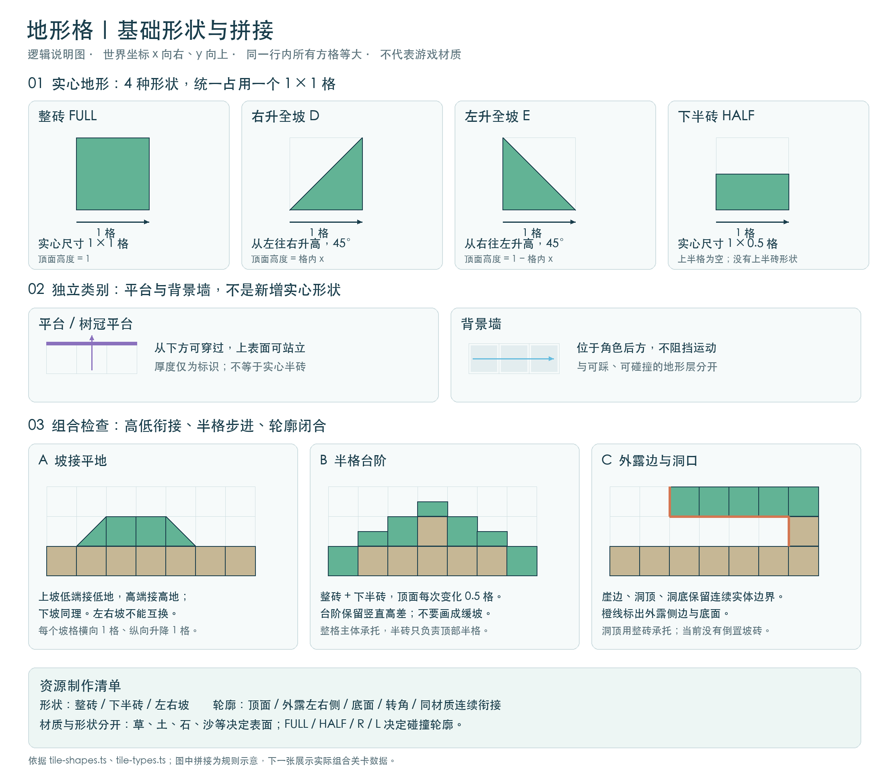
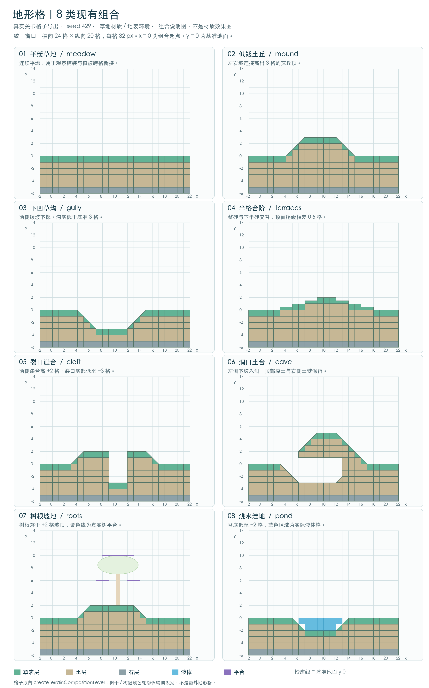

# 地形瓦片与组合

制作清单分成三层：4 种实心形状、独立的平台与背景墙、8 类可复用地形组合。每种材质都需要检查顶面、左右外露侧面、底面、转角和相邻格接缝；材质决定外观，形状决定碰撞轮廓。

[打开基础形状与拼接说明图 ↗](terrain-tile-basics.png)

## 基础形状与独立图层

**背景墙**

**1 × 1**

图中按一格模块示意，位于人物身后，不阻挡、不承托角色。可与实体地形处在同一平面坐标。

**整格地形砖**

**1 × 1**

实心地形，提供站立表面并阻挡角色。正面与图中的背景墙模块同宽同高。

**下半高地形砖**

**1 × 0.5**

占格子的下半部分，与整格砖同宽，仍是实心地形；本图展示自然地形的四种基础轮廓；建筑上半砖、倒置斜坡等完整形态另见[格子形态定义](tile-shape-definitions.md)。

**左右斜坡**

**1 × 1**

各占一格边界，分别为左升全坡、右升全坡；坡面为角色提供倾斜落脚面。

**平台**

**薄板**

从下方可跳过，从上方可站立；与实心半高砖的碰撞行为不同。

远景背景位于更远处，负责天空、山体等空间层次。背景墙填充人物身后的房间或洞穴；实体地形构成脚下地面和可碰撞边界。图中的模块色块只说明尺寸，不是游戏材质截图。

## 需要覆盖的 8 类组合

下图直接读取游戏的组合关卡格子：统一种子 429、草地材质、地表环境。8 个面板均为 24 × 20 格、每格 32 像素；橙虚线为基准地面，蓝色为液体，紫线为真实平台。它展示逻辑轮廓，不代表最终材质效果。

[打开 8 类组合完整说明图 ↗](terrain-combinations.png)

**平缓草地**

**meadow**

连续地面与成片植被，观察疏密和跨格衔接。

**低矮土丘**

**mound**

两侧缓坡接入宽丘顶，草皮沿连续轮廓生长。

**下凹草沟**

**gully**

坡肩、坡脚和沟底形成同一段凹地形。

**半格台阶**

**terraces**

整格和半格交替，以半格高差逐级上下。

**裂口崖台**

**cleft**

完整崖台之间留出裂口，沟底保留实际落脚面。

**洞口土台**

**cave**

厚土顶由侧壁承托，可沿下坡进洞并原路返回。

**树根坡地**

**roots**

正式阔冠树的根盘贴合高低坡面，树冠平台可站立。

**浅水洼地**

**pond**

封闭浅盆、真实液体和岸边植物共同构成湿地。

拼接要求：坡的低端接低地、高端接高地；台阶保留 0.5 格高差；崖台保留侧壁与沟底；洞口保留厚顶、承托壁和通行空间；树冠平台与树轮廓分开；洼地的实体盆底与液体分层。本图不展示上半砖与倒置坡；建筑可用形态和同格组合按[格子形态定义](tile-shape-definitions.md)处理。

 [打开场景功能展示，对照真实组合 ↗](../?mode=lab)
