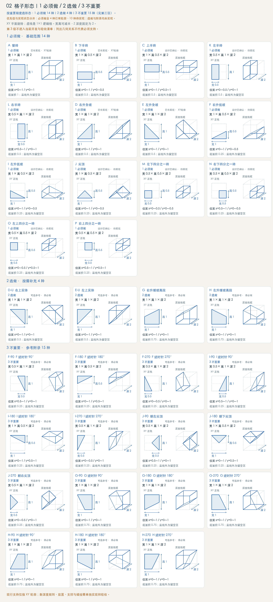
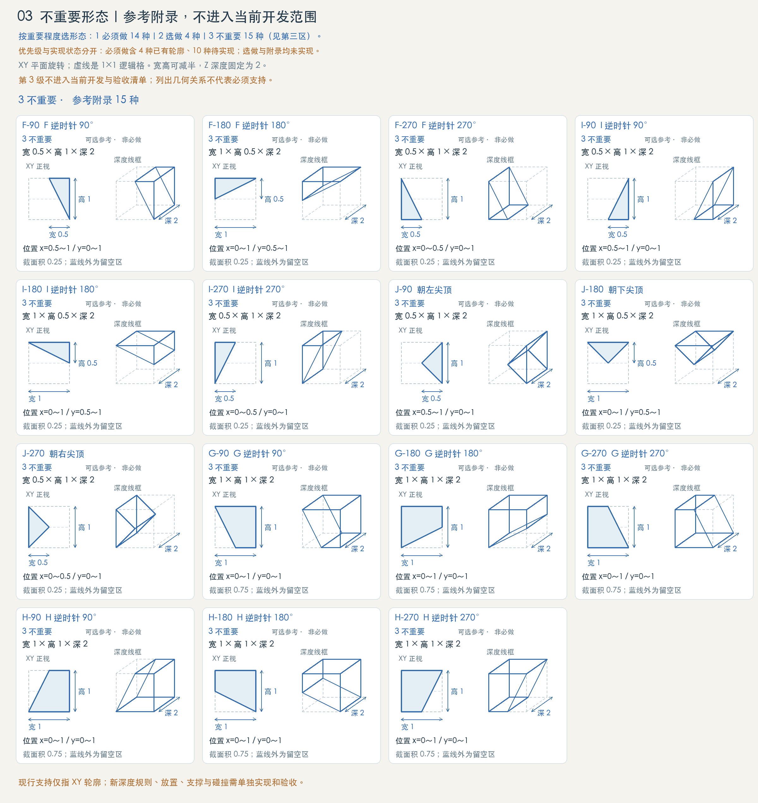

# 格子形态与支持范围定义

状态：形态定义与建造规则（2026-10-16）。共享形态库包含全部33种轮廓，建筑材料按各自支持范围使用。当前放置和组合规则以本页正文及材料与构件库为准；旧图上的“仅四种已实现”“同格仅一种”和开发优先级标签属于历史制图标注。

## 1. 形态与实现范围

完整形态由 `src/config/definition-kit.ts` 维护；材料支持的形态由共享资源配置决定，见[材料与构件库](material-library.md)。形态是材料内部的变化，不计为新材料。以下表格保留原图编号与历史分组，便于对照图谱，不限制当前建造列表中的已提供形态。

## 2. 坐标、尺寸与深度

逻辑格为XY平面的1×1单元，X向右、Y向上。格内坐标x、y都在[0,1]；每个实体由本节表中的多边形顶点依次连接并闭合定义，再沿Z挤出2格。顶点表是精确实体范围，包围盒不表示全部填实。表中“截面积”为XY多边形面积，体积＝截面积×2格³。

格子深2，Z=[−1,+1]；前沿[+1,+1.5]（镜头一侧）与后沿[−1.5,−1]在格子之外各0.5，前沿放花草、突出岩，后沿放背景墙、灌木、大岩。背景墙标准宽1×高1×厚0.2，XY完整覆盖一格、不缩边，位于后沿Z=[−1.2,−1]，紧贴格子背面，与格子零交集。总空间带宽为3格。坐标约定见 core-coordinates.md。

上下半砖为1×0.5×2，左右半砖为0.5×1×2。半高坡旋转90°后变成半宽竖向坡，宽高互换，深度不变。后缀-90/-180/-270表示在XY平面内绕逻辑格中心逆时针旋转对应角度；-U表示沿y=0.5上下镜像。

四分之一砖M/N/O/P均为0.5×0.5×2，正面占1/4格、截面积0.25、体积0.5格³，分别位于左下、右下、左上、右上；其余3/4格留空。这里指宽高各半的方块，不是1×0.25薄条，也不是深度缩为1/4。F/I/J虽然截面积同为0.25，但属于斜块，不能替代四分之一方砖。

## 3. 形态清单与精确轮廓

总计33种：整砖1、矩形半砖4、四分之一砖4、整格三角坡4、半尺寸单斜块8、双斜尖顶4、缓坡高段8。A～L保留原编号，M/N/O/P为四角四分之一砖，后缀表示参考变体。

## 1 必须做 · 基础范围 14 种

| 编号 | 形态 | 优先级 | 支持状态 | 宽×高×深 | 实体顶点（依次闭合） | 截面积 |
| --- | --- | --- | --- | --- | --- | --- |
| A | 整砖 | 1 必须做 | 共享形态已接入 | 1×1×2 | (0,0) → (1,0) → (1,1) → (0,1) | 1 |
| B | 下半砖 | 1 必须做 | 共享形态已接入 | 1×0.5×2 | (0,0) → (1,0) → (1,0.5) → (0,0.5) | 0.5 |
| C | 上半砖 | 1 必须做 | 共享形态已接入 | 1×0.5×2 | (0,0.5) → (1,0.5) → (1,1) → (0,1) | 0.5 |
| K | 左半砖 | 1 必须做 | 共享形态已接入 | 0.5×1×2 | (0,0) → (0.5,0) → (0.5,1) → (0,1) | 0.5 |
| L | 右半砖 | 1 必须做 | 共享形态已接入 | 0.5×1×2 | (0.5,0) → (1,0) → (1,1) → (0.5,1) | 0.5 |
| D | 右升全坡 | 1 必须做 | 共享形态已接入 | 1×1×2 | (0,0) → (1,0) → (1,1) | 0.5 |
| E | 左升全坡 | 1 必须做 | 共享形态已接入 | 1×1×2 | (0,0) → (1,0) → (0,1) | 0.5 |
| F | 右升低坡 | 1 必须做 | 共享形态已接入 | 1×0.5×2 | (0,0) → (1,0) → (1,0.5) | 0.25 |
| I | 左升低坡 | 1 必须做 | 共享形态已接入 | 1×0.5×2 | (0,0) → (1,0) → (0,0.5) | 0.25 |
| J | 尖顶 | 1 必须做 | 共享形态已接入 | 1×0.5×2 | (0,0) → (1,0) → (0.5,0.5) | 0.25 |
| M | 左下四分之一砖 | 1 必须做 | 共享形态已接入 | 0.5×0.5×2 | (0,0) → (0.5,0) → (0.5,0.5) → (0,0.5) | 0.25 |
| N | 右下四分之一砖 | 1 必须做 | 共享形态已接入 | 0.5×0.5×2 | (0.5,0) → (1,0) → (1,0.5) → (0.5,0.5) | 0.25 |
| O | 左上四分之一砖 | 1 必须做 | 共享形态已接入 | 0.5×0.5×2 | (0,0.5) → (0.5,0.5) → (0.5,1) → (0,1) | 0.25 |
| P | 右上四分之一砖 | 1 必须做 | 共享形态已接入 | 0.5×0.5×2 | (0.5,0.5) → (1,0.5) → (1,1) → (0.5,1) | 0.25 |

## 2 选做 · 按需补充 4 种

| 编号 | 形态 | 优先级 | 支持状态 | 宽×高×深 | 实体顶点（依次闭合） | 截面积 |
| --- | --- | --- | --- | --- | --- | --- |
| D-U | 右上实体 | 2 选做 | 共享形态已接入 | 1×1×2 | (0,1) → (1,1) → (1,0) | 0.5 |
| E-U | 左上实体 | 2 选做 | 共享形态已接入 | 1×1×2 | (0,1) → (1,1) → (0,0) | 0.5 |
| G | 右升缓坡高段 | 2 选做 | 共享形态已接入 | 1×1×2 | (0,0) → (1,0) → (1,1) → (0,0.5) | 0.75 |
| H | 左升缓坡高段 | 2 选做 | 共享形态已接入 | 1×1×2 | (0,0) → (1,0) → (1,0.5) → (0,1) | 0.75 |

## 3 不重要 · 参考附录 15 种

| 编号 | 形态 | 优先级 | 支持状态 | 宽×高×深 | 实体顶点（依次闭合） | 截面积 |
| --- | --- | --- | --- | --- | --- | --- |
| F-90 | F 逆时针 90° | 3 不重要 | 共享形态已接入 | 0.5×1×2 | (1,0) → (1,1) → (0.5,1) | 0.25 |
| F-180 | F 逆时针 180° | 3 不重要 | 共享形态已接入 | 1×0.5×2 | (1,1) → (0,1) → (0,0.5) | 0.25 |
| F-270 | F 逆时针 270° | 3 不重要 | 共享形态已接入 | 0.5×1×2 | (0,1) → (0,0) → (0.5,0) | 0.25 |
| I-90 | I 逆时针 90° | 3 不重要 | 共享形态已接入 | 0.5×1×2 | (1,0) → (1,1) → (0.5,0) | 0.25 |
| I-180 | I 逆时针 180° | 3 不重要 | 共享形态已接入 | 1×0.5×2 | (1,1) → (0,1) → (1,0.5) | 0.25 |
| I-270 | I 逆时针 270° | 3 不重要 | 共享形态已接入 | 0.5×1×2 | (0,1) → (0,0) → (0.5,1) | 0.25 |
| J-90 | 朝左尖顶 | 3 不重要 | 共享形态已接入 | 0.5×1×2 | (1,0) → (1,1) → (0.5,0.5) | 0.25 |
| J-180 | 朝下尖顶 | 3 不重要 | 共享形态已接入 | 1×0.5×2 | (1,1) → (0,1) → (0.5,0.5) | 0.25 |
| J-270 | 朝右尖顶 | 3 不重要 | 共享形态已接入 | 0.5×1×2 | (0,1) → (0,0) → (0.5,0.5) | 0.25 |
| G-90 | G 逆时针 90° | 3 不重要 | 共享形态已接入 | 1×1×2 | (1,0) → (1,1) → (0,1) → (0.5,0) | 0.75 |
| G-180 | G 逆时针 180° | 3 不重要 | 共享形态已接入 | 1×1×2 | (1,1) → (0,1) → (0,0) → (1,0.5) | 0.75 |
| G-270 | G 逆时针 270° | 3 不重要 | 共享形态已接入 | 1×1×2 | (0,1) → (0,0) → (1,0) → (0.5,1) | 0.75 |
| H-90 | H 逆时针 90° | 3 不重要 | 共享形态已接入 | 1×1×2 | (1,0) → (1,1) → (0.5,1) → (0,0) | 0.75 |
| H-180 | H 逆时针 180° | 3 不重要 | 共享形态已接入 | 1×1×2 | (1,1) → (0,1) → (0,0.5) → (1,0) | 0.75 |
| H-270 | H 逆时针 270° | 3 不重要 | 共享形态已接入 | 1×1×2 | (0,1) → (0,0) → (0.5,0) → (1,1) | 0.75 |

## 4. 半高坡与尖顶的区别

F顶线y=0.5x，I顶线y=0.5−0.5x，坡角约26.6°。J顶线y=min(x,1−x)，尖顶位于(0.5,0.5)，两端落底；左右各宽0.5，两坡均为45°，没有平顶。J占一个格，不能与两个格宽的F+I混淆。

G顶线y=0.5+0.5x，H顶线y=1−0.5x；高段包含下半格实体，截面积0.75，不是悬空薄片。G/H以及全部旋转变体均为可选参考。倒置与侧向形态应按多边形定义，不能一律用从格底向上填充的顶高公式。

## 5. 结合、放置与外观边界

同一个逻辑格允许实际多边形互不重叠的多块组合。支持 B+C、K+L、M/N/O/P 四小块及互补斜块；仅边界接触不算实体重叠。每块独立保存、选中、替换和拆除，组合不合并成不可拆分的新材料。相邻格按整数坐标放置，普通深度 Z=[−1,+1]；加深为 Z=[−1.5,+1.5]。任一部分加深时，整个逻辑格禁止背景墙，双向放置均检查。

地面组合：F+B+I在两处接缝都高0.5；J+J在格边界的高度为0，形成坡谷；J接B有0.5高差。可选缓坡组合F+G在接缝处高0.5，两格升高1；H+I为下降镜像。端点连续不代表已验证角色可通行。

倒置和侧向组合需比较共同边上的实际实体区间，不能只比较顶高。部分接触、尖点接触和空隙须分别识别，不自动算作完整支撑。内部面仅在确被邻格实体遮挡时隐藏；暴露面、坡面及留空区保留。背景墙不填补实体缺口。此处是几何与美术约束，具体放置和支撑算法尚未定稿。

门侧半格是安装范围，不等于门框必须填满半砖；门仍单独定义净洞3格、上方1格高一体门沿。家具、装饰和平台不因外观相似就使用实心半砖碰撞。

## 6. 实现范围与验收约定

资料库、自由搭建场与住宅使用同一份形态定义和资源配置。验收时核对四小块共格、互补斜块共格、重叠拒绝、逐块选择替换拆除，以及任一加深部分与整格背景墙的双向互斥。

材料、形状、逻辑占格和表面拼缝分开定义。米黄色方石块的两格合缝是外观拼接，不把两个可编辑格子合成一份存档。曲面和凹槽不在当前形态库内。

历史图仍可用于核对轮廓和标尺，其旧开发分级与实现状态不覆盖本页规则；实际可用资源与尺寸见[材料与构件库](material-library.md)。

## 透视图与交互演示

[阅读完整定义与支持清单 ↓](../?mode=concepts#building-shape-spec)

